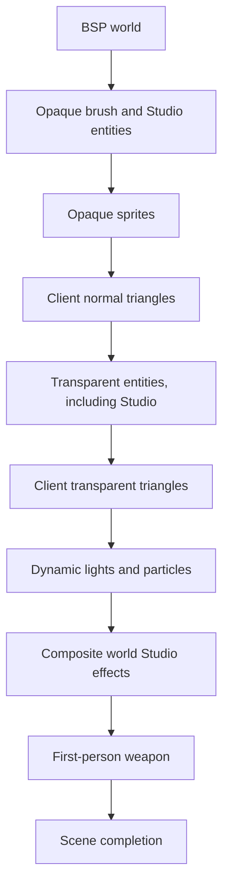
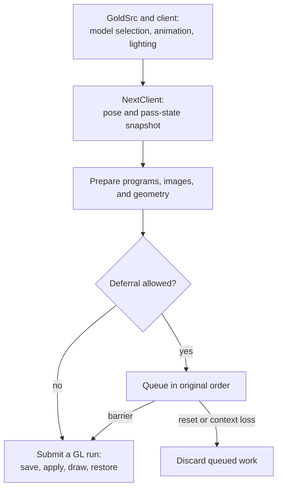
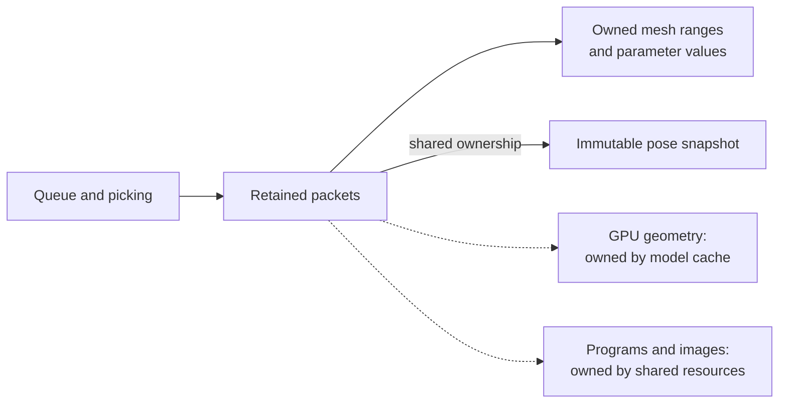
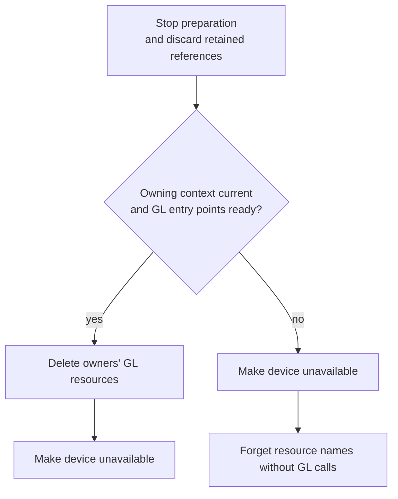

# Studio renderer architecture

[Russian translation](renderer-architecture.ru.md) | [Diagnostics](renderer-diagnostics.md)

## Division of responsibility

NextClient and GoldSrc render the same frame in one OpenGL context. GoldSrc and the client callbacks select Studio models (`.mdl` players, weapons, and props), compute animation, bone transforms and attachments, and process events. NextClient takes over their geometry submission: shaders transform the static model vertices using the completed pose and shade the resulting surface. BSP world and brush geometry continue through the stock engine. Radar and text have separate rendering paths.

The interception sits at the Studio API boundary, preserving the engine calculations surrounding a draw. NextClient also schedules the scene stages, so deferred Studio work must finish before another stage uses its results or changes shared state. The shader path requires an OpenGL 3.3 compatibility context because GoldSrc still uses the fixed-function pipeline. Disabling the path or rejecting a submission returns geometry drawing to the stock renderer. Accepted models skip the stock planar shadow, which requires CPU-transformed vertices. This limit matters when comparing images.

## Scene order

The diagram shows the main stages of a normal world view with entity drawing enabled. Studio participates in both entity traversals; the first-person weapon renders separately. Queue barriers within each traversal are described below.

## From an engine draw to a prepared packet

The diagram shows a successfully prepared shader draw. Deferred and immediate paths use the same prepared packet and GL state-restoration rules.

While GoldSrc is processing an entity, the renderer captures everything needed to reproduce that model pass later. A draw packet owns the selected mesh ranges and copies lighting, view matrices, fog, raster inputs, selected base skins, and mutable material values. Skin selection occurs while the engine's current entity and forced flags still describe that draw. Submission therefore does not have to revisit a live entity or consult a material that may already have changed. Built-in shaders reproduce captured engine fog (linear, exponential, or exponential squared) while preserving surface alpha.

The complete bone pose is captured once per model draw and shared through an immutable handle. Body parts and preview capture retain that same snapshot without copying the palette or observing a later animation pose. Effects use the same snapshot while drawing. A pose-pool reset does not invalidate retained handles. Sharing geometry or a pose does not merge the remaining state of separate packets.

Preparation resolves programs, material bindings, and image dependencies before publishing a packet to the queue, effects, or picking. Draw loops receive prepared numeric bindings and image identities; they perform no image loading or catalog lookup. A missing material image follows the cache's neutral-image fallback.

Resource loading can synchronously call back into the engine and trigger a reset or unload. Preparation keeps its completed values locally owned during such calls and rechecks the operation and resource identities before using borrowed model data or publishing results. An invalidated operation stops without caching a canceled image load. This separates an ordinary missing resource from a draw whose context or session no longer exists.

## Shared geometry and resource ownership

Solid arrows show data ownership; dashed arrows show borrowed resources. Packet copies own their parameter values and share the immutable pose. Borrowed GPU resources require a separate release boundary. Effects consume a prepared packet synchronously and retain their own masks.

One cached model contains the geometry of all its body variants in a static vertex/index buffer pair. Mesh ranges retain their boundaries, and the engine chooses which ranges the current entity uses. Entities using the same cached model can share those buffers while supplying different poses, skins, materials, and view state. CPU conversion arrays are released after upload. Metadata is prepared independently without GL and remains available for material lookup and authoring even when GPU preparation fails. Preview rendering creates GPU geometry on first draw and reuses it afterward.

`RendererResources` owns the device, shader programs, material catalog, and images. `RendererState` composes the model, material, Studio, preview, and lifecycle owners around those resources. The submission runtime and packets borrow prepared programs and geometry; they do not own their deletion. Resource owners must outlive these borrowers, and queued or captured references must finish or be discarded before the referenced resources change.

Cache identity includes the model session as well as the copied model name and header identity. A reused engine address cannot make geometry from another session valid. A separate texture companion is tracked as a dependency: retiring it invalidates dependent texture/material readiness while preserving independent main-model metadata and geometry. Shader generations and texture revisions similarly prevent packets and cached bindings from using replaced GPU resources.

## Why deferral and batching have boundaries

The queue preserves the existing opaque and transparent entity order, including each model's base pass before its shell pass. It groups consecutive eligible packets into one submission run, sharing the cost of saving and restoring caller GL state. This does not authorize sorting by program or texture. Additive blending and even opaque surfaces at equal depth can change appearance when their order changes.

Within an ordinary packet, only adjacent meshes with equal consumed state can share a `glMultiDrawElements` call. The call lists ranges in the existing buffers and reduces CPU API calls without changing the selected triangles. Each ordinary packet still binds its first program and supplies its own uniforms, matrices, and bones, even if the preceding packet used that program. Rigid union instancing combines adjacent eligible packets when geometry proves one consumed bone per range and their captured shared state matches exactly. Authored materials and other ineligible packets retain ordinary submission. See the [rigid submission procedure](testing/studio-rigid-instancing.md) for eligibility and measurement.

A barrier submits queued work before an external draw, a Studio event callback, resource replacement, or the end of an entity traversal. This keeps sprites, brush models, stock fallback, and client drawing in their correct positions. First-person weapons and ordinary previews submit immediately. Models using engine-remapped skins also submit immediately because another entity can change the same texture's contents; capturing its GL name would not preserve its pixels.

Custom Studio callbacks that issue raw GL calls must establish their own flush/pause boundary or use `r_studio_queue 0`. On rejection, already accepted work finishes before stock submission, rejected meshes are removed, and later parts of that draw remain on the stock path. These boundaries prevent both reordered output and duplicate geometry.

## Sharing the OpenGL context

`StudioGlSubmission` owns GL state only while submitting a run. It saves the caller state it touches, applies each packet's captured inputs, and restores the caller state before returning to engine or client preparation. Its state cache covers only changes within that run. Matching values left by a different renderer cannot justify skipping setup. Material samplers occupy a separate range from the base skin and engine-reserved texture units; replay and restoration also synchronize the engine's base-texture bookkeeping. Submission returns with texture unit 0 active, as required at the engine boundary.

State restoration is valid only while the owning native context remains current. A session reset with that context still alive can restore caller bindings while canceling further drawing. Loss or replacement of the context abandons the saved GL state: restoring old object names into a new context would address unrelated resources. Full GL snapshots and native-context checks surround actual cold image loading; warmed preparation uses owner revisions without adding those snapshots to every draw.

## Materials, effects, and previews

Material selection combines entity server bindings, model documents, and built-in defaults; an active edit session can override its target. The packet copies the chosen values, so editor or server changes affect later preparation independently. A validated manifest supplies the common surface-coverage contract for color rendering, effects, and picking. These passes use the same pose, image inputs, and visibility rules, keeping dissolved fragments and masked holes consistent. Server authorization remains a separate material-owner decision.

Preview scenes reuse Studio preparation and submission with their own camera and interaction state. Each effects view owns its masks; cancellation stops that view without compositing its results or canceling an enclosing view. Preview references must be discarded before releasing the shared Studio resources they borrow. Material formats, effect behavior, editing, and synchronization are described in the [material format](weapon-materials.md), [effects](material-effects.md), [authoring guide](weapon-materials-authoring.md), and [server API](weapon-materials-server-api.md).

## Reset, context loss, and shutdown

At context release or loss, ordering depends on whether GL calls are safe. The diagram shows this boundary; a map change that retains the context is handled separately.

`RendererLifecycle` coordinates resource owners across map changes, disconnects, context changes, and shutdown. The central rule is to remove borrowed work before invalidating what it references. A live model replacement first drains valid packets; ending a session discards packets that can no longer be submitted safely. Map reset clears model geometry and material images while retaining shader programs. Context loss retains owned CPU metadata for the current model session, with GPU resources recreated on later use.

Live release deletes GL resources explicitly before the device becomes unavailable, and requires a matching current native context with initialized GL entry points. Loss instead makes the device unavailable and forgets names without GL deletion. Destructors also forget names and unregister ownership without depending on a surviving context. Resizing the same prepared context preserves its resources; a new context requires a new resource generation.

Terminal shutdown stops copied Studio and preview callbacks before nested engine cleanup and releases resources before their engine providers expire. Original callback copies remain available for forwarding. Standalone drawing shutdown permits later context creation.

## Shaders and settings

Shader sources and program manifests are embedded in the engine module. Programs compile for the current GL context. Changing an embedded shader requires rebuilding and installing the module, then restarting the client. See [embedded shader preparation](renderer-diagnostics.md#embedded-shader-preparation) for startup and warmup options.

| Setting | Default | Purpose |
|---|---|---|
| `r_studio_shader` | `1` | Enables the Studio shader path. |
| `r_studio_queue` | `1` | Allows ordered deferral in opaque and transparent entity traversals. |
| `r_studio_materials` | `1` | Enables authored materials. |

The queue preserves ordering and packet compatibility across instanced batches and ordinary fallback. Use the [rigid submission procedure](testing/studio-rigid-instancing.md) to verify eligibility, output, and submission counters.

## Source map and verification

| Question | Starting point |
|---|---|
| Where are engine inputs captured? | [StudioIntercept.cpp](../nextclient/engine_mini/src/graphics/render/StudioIntercept.cpp), [StudioRenderer.cpp](../nextclient/engine_mini/src/graphics/render/StudioRenderer.cpp) |
| Where are ordering and submission enforced? | [StudioQueue.cpp](../nextclient/engine_mini/src/graphics/render/StudioQueue.cpp), [StudioSubmit.cpp](../nextclient/engine_mini/src/graphics/render/StudioSubmit.cpp) |
| Who owns cached model data? | [StudioModelCache.cpp](../nextclient/engine_mini/src/graphics/render/model/StudioModelCache.cpp) |
| Who coordinates resource lifetime? | [RendererLifecycle.cpp](../nextclient/engine_mini/src/graphics/render/RendererLifecycle.cpp), [RenderDevice.cpp](../nextclient/engine_mini/src/graphics/render/RenderDevice.cpp) |

The [renderer owner rules](../nextclient/engine_mini/src/graphics/render/AGENTS.md) specify implementation invariants. [Diagnostics](renderer-diagnostics.md) cover commands, captures, and counters; fewer API calls alone do not establish a speedup. [Studio verification](testing/studio-rendering.md) and [material scene verification](testing/material-editor-scene.md) separate automated coverage from developer observations in the installed engine.
