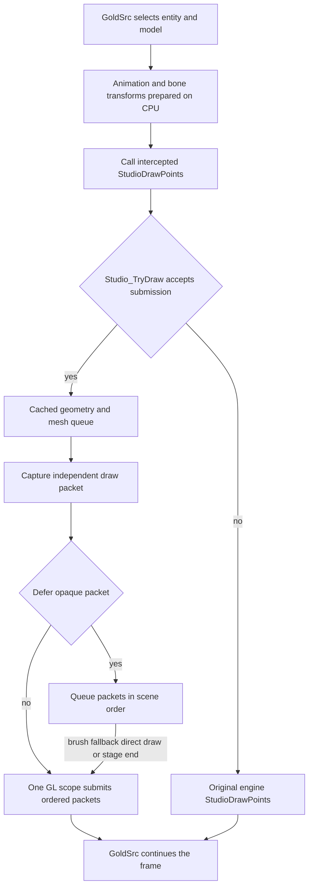
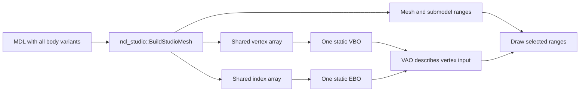
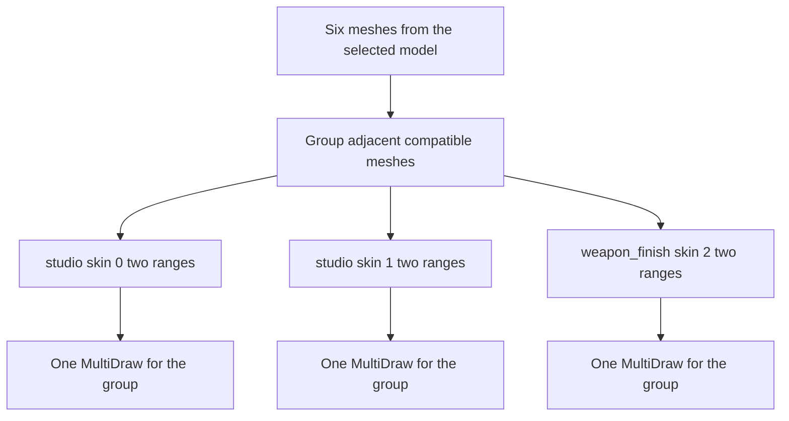

# NextClient shader rendering

[Russian translation](renderer-architecture.ru.md) · [Overview and flowcharts](shader-rendering.md) · [Diagnostics](renderer-diagnostics.md) | [Material format](weapon-materials.md) | [Verification cases](testing/studio-rendering.md)

NextClient draws Studio models through static GPU buffers and shaders. GoldSrc selects models, computes animation, and prepares each draw. Studio models are players, weapons and other `.mdl` objects. GoldSrc still draws the BSP world: `R_DrawWorld` and `R_DrawBrushModel` delegate to `hw.dll` or `hw.so`.

A mesh is a model region with its own triangle range and skin reference. A body part can contain several meshes; for a weapon, body parts can represent construction components.

The implementation has these properties:

| Property | Current implementation |
|---|---|
| Geometry storage | All parts of one model file occupy one vertex/index buffer pair. Mesh boundaries remain intact. |
| Mesh batching | Meshes from the selected body parts of one model are grouped and submitted through `glMultiDrawElements`. |
| Repeated models | Instances share cached geometry when possible and consecutive opaque packets share a GL state scope. Each pose retains its own draws. |
| Group key | Equal program, skin, captured texture and all consumed mesh/material inputs within one packet. |
| Program selection | The program changes when the next group requires it. Many modes of one program are selected through uniforms. |
| Requirements and default | `r_studio_shader` defaults to `1`. The studio path requires OpenGL 3.3. |

Mesh grouping submits several geometry ranges through one MultiDraw call. It reduces CPU calls into OpenGL while submitting the same triangles.

## Resource and state ownership

The `render` namespace groups the renderer subsystem types, functions, and constants, including `render::GpuBuffer`, `render::IDeviceResource` and `render::StudioDrawQueue`. The DLL-facing scene and material interfaces remain public engine contracts. Material documents and model conversion use the qualified `ncl_material` and `ncl_studio` APIs. Parser and writer implementation helpers stay in `ncl_material::detail`. Frame capture uses `ncl_gl::FrameImage`, `ncl_gl::CaptureFramebuffer` and `ncl_gl::WriteTga`.

### Device, resources, and models

`RendererResources` composes `RenderDevice`, `ShaderManager`, `MaterialManifestCatalog`, and `MaterialTextureCache` in dependency order. `RenderDevice` owns the registry, native context identity, capabilities, and generation. Shader and image owners register at construction, unregister at destruction, and forget names without GL calls during destruction or context loss. Explicit clearing deletes names only with the owning context current.

The integration texture-clear adapter drains queued work before clearing. `ShaderManager` receives a cold shader/source backend, the catalog receives that concrete shader owner and a cold localization/diagnostic backend, and the texture cache receives the device and a cold image loader. Warmed cache hits add no allocation or virtual dispatch; shader and image requests preserve direct native-context validation. Existing free functions forward to these owners for integration consumers.

`RendererState` borrows the unique `RendererResources` root and constructs `MaterialCoverageRuntime`, `StudioEffects`, `MaterialDocumentStore`, `ServerMaterials`, `StudioModelCache`, and `MaterialEditor` in dependency order. Its production composition owns the cold `MaterialGameFiles` backend before the store. Game initialization binds the mod directory used for writes. The store centralizes model/editor document reads, writes, parsing diagnostics, and bounded server preset reads; the server owner supplies its 1 MiB limit without limiting ordinary documents.

Each cache receives concrete device, document, catalog, shader-generation, and server-generation owners. `StudioRenderer` binds model/server references once and calls them directly during preparation. `BindingFor` receives the live network-state condition from that boundary. A model preparation operation receives its resource barrier explicitly and invokes it only before actual stale-entry replacement. Cache hits perform no barrier callback or extra lookup. `StudioGeometry` and `GpuBuffer` use their supplied device for registration and native-context checks. Destruction forgets names and unregisters; explicit release owns live GL deletion.

`StudioRenderer` constructs `StudioMaterialRuntime(ShaderManager&, MaterialManifestCatalog&, MaterialTextureCache&, performance::PerformanceMonitor&)` from concrete resource owners and passes it by reference to `StudioGlSubmission`. Those owners outlive the runtime. Construction performs no resource lookup or GL calls. The shader generation is always nonzero; borrowed program pointers remain valid until it changes. The runtime owns program descriptor strings, generation-checked program pointers, the last configuration key, and 256 normalized light-gamma values. `StudioShaderInterface.h` defines the ordered uniform table, shade-mode values and defines, gamma-table sizes, and built-in descriptor. `Studio_OnGammaChanged` copies every fourth engine gamma-table entry and divides it by 1023; first-draw preparation uses the same adapter. The runtime does not access engine state.

`RendererState` composes preview bindings, the native model backend and repository before `StudioRenderer`; it then constructs `StudioInterceptState`, `PreviewModelRenderer`, `ScenePreview`, `TestQuad`, `RenderCaptureSession`, and `RendererLifecycle`. The renderer receives concrete device, shader, manifest, texture, model, server-material, editor-session, effects, engine-binding, and diagnostic owners. It owns material runtime, GL submission, queue, preparation caches, rejection state, and the nested preview input stack. Constructors perform no engine or GL work. Preview rendering supplies the renderer directly; the renderer has no dependency on a scene or preview-model owner.

### Interception and frame capture

`StudioInterceptState` owns original and installed ABI tables, borrowed current model/header/submodel, the draw serial, copied lighting, and stock-forwarding state. Process-lifetime ABI trampolines select the composition owner; their methods call its renderer directly. `StudioModelInputs` supplies the original API, captured identity/lighting/serial, and a synchronous reference to the live serial source. Loading callbacks must be followed by a serial check before borrowed pointers are consumed. Packets never retain that source. `StudioEngineBindings` binds resolved native storage at initialization, captures controls/view values at the operation boundary, converts gamma values at notification, and synchronizes engine unit-0 bookkeeping when captured skins are bound.

`RenderCaptureSession` owns the two-frame A/B state and exact saved cvar strings. `Begin` receives the actual cvar owners; a cold native backend performs cvar writes, framebuffer/file operations, and completion output. Cancellation removes pending state before callbacks and restores shader then material values while their native storage is valid. `StudioDiagnostics` owns armed records and entity-light watches, with explicit engine bindings and scene-end path/time inputs. `TestQuad` receives its actual device and shader manager, and live lifecycle release deletes its GL resources before device invalidation. Destructors only release CPU ownership or unregister.

### Mesh storage and shared bindings

The queue and preview interaction each own an independent `StudioMeshStorage` with a separate 1 MiB retained mesh-payload budget. Retirement clears borrowed program, prepared material-binding, and texture identities while preserving complete owned material values. The charge includes mesh, parameter and overlay capacities and all retained string capacities, including inactive texture-reference strings; small-string capacity is conservatively charged. Allocator metadata and bookkeeping are outside this payload budget, as are active packets.

Acquisition subtracts the saved charge; reset, picking close, loss, and cancellation release retained payloads. A private pending `mesh_count` limits skin searches and rollback, and meshes are trimmed to that count before picking, effects, or queue publication. Compatible shapes reuse nested capacities; shape changes, absent materials, budget rejection, and restricted-policy tail rewriting can allocate. Retirement adds a bounded accounting walk. This mechanism establishes targeted capacity reuse, without a measured speedup or a general zero-allocation guarantee.

`StudioBindings.h` is the shared layout for submission, broad GL scopes, effects, and previews: bone binding `0`, base texture unit `0`, engine-reserved units `1` and `2`, and eight material units beginning at `3`. `kStudioTouchedTextureUnits` controls broad sampler preservation and preview cleanup. The consumer asserts that the material range matches the package limit, fits the capture mask, and stays within the 16 fragment units guaranteed by GL 3.3.

`Manifest_Get` publishes only embedded shader pairs with matching manifests and validated renderer contracts. `StudioContract_For` reads that checked enrollment. `StudioContract_EffectsV1` exposes an immutable GLSL layout for resetting coverage uniforms and grants no material capability. Coverage upload, preview picking, effect admission, projected bounds, mask inputs, and composition read semantic descriptors and manifest defaults from one profile. `StudioContract_DisableRestrictedEffects` writes explicit scalar zeros for both restricted activations, even when material values are omitted. Their finite defaults may vary within the fixed range; all other semantic defaults are exact. See the [manifest contract and extension procedure](weapon-materials.md#program-manifest).

### Editor and server synchronization

`MaterialEditor` receives the concrete model, server-material, shader, manifest, and document owners. It owns a `MaterialEditSession` value with model/entity selection, copied texture materials, and parameter-preview rollback snapshots. The exported `render::MaterialEditInterface` returns that same editor instance from `RendererState`. Cold API methods supply the current connection-state predicate to source operations so each subsequent texture observes reentrant loading/reset. `StudioRenderer` binds a direct const session reference once and supplies authoring availability at the draw boundary. Override lookup reads only owned entries, with no virtual call, allocation, catalog lookup, or file access. Save merges selected entries through the injected store and calls `StudioModelCache::ReloadDocuments` directly.

`ClientStringRegistry` owns a bounded table of 2048 strings and constructs without engine calls or message registration. The `cl_string_registry` integration adapter parses messages, registers commands, and explains capacity failure before disconnecting. `engine.cpp` supplies the unique registry and server-material owners to `MaterialSyncSystem`. The handler copies all registry values before preset-loading calls, distinguishes full material replacement from complete parameter replacement, publishes wire snapshots only after replacement succeeds, and removes the previous owner only after successful migration. `CL_ClearClientState` clears the renderer session/borrowed work, synchronized owners, string registry, then server materials.

`MaterialSyncSystem` owns wire IDs, deltas, and registry-string translation. `ServerMaterials::ReplaceOwner` copies an owner's ordered binding requests and complete parameters; `ServerMaterials::ReplaceOwnerParams` resets only that owner's candidates from cached preset defaults and synchronized effect policy. `ServerMaterials::RemoveOwner` preserves other owners and console state. Restricted-effect policy receives the checked manifest from the same owner's catalog; the explicit contract helpers use only that supplied manifest. Each rendered entity indexes its owners and retains resolved candidates excluded by the 16-texture admission limit. Console textures reserve slots first, followed by descending synchronized owner ID and request order. Shared textures use one slot; the first valid request fixes its order and the last valid assignment supplies the material. Admission changes preserve unaffected material copies. `BindingFor` and `AnyBindingMatches` exclude unadmitted textures; the predicate still considers shadowed owners on admitted textures. Query pointers are borrowed until material mutation, and queued meshes own material copies. See the [server API](weapon-materials-server-api.md) for synchronization and capacity rules.

### Image preparation

Image preparation is a separate synchronous phase. `FlushPending` trims the private mesh range, moves the complete pending value into a local completed packet, and resets the builder before cold loads. The local packet owns every material/path during reentry. A synchronous `TextureLoadGuard` checks stable renderer, shader, texture, and device identities immediately after the native texture callback; canceled loads create no GL texture and publish no cache result. Normal missing images retain cached failure and neutral fallback semantics. Every mesh stores fixed numeric sampler and coverage-image bindings plus the accepted manifest; coverage preparation also handles samplers optimized out of the color program. Color, effects, and picking perform no image loading, path lookup, or catalog resolution. Each packet carries the texture cache revision, checked at consumer entry. Retirement clears all numeric image identities and borrowed manifest/program records.

Only a real native image-cache miss takes a GL snapshot. Warmed packet preparation reads direct owner epochs and the device's established identity without an additional native-context query or GL snapshot. Native loading validates its actual current context around external callbacks. Preview continuations stop after cancellation, and context-aware scopes abandon captured GL state after loss or replacement. A live session reset may restore valid caller state while stopping subsequent models, picking, and presentation. These guarantees cover NextClient continuations; the closed engine's arbitrary continuation after its callback is outside the observed boundary.

## Integration with GoldSrc

NextClient also owns scene scheduling. The `R_RenderView` hook in [`engine.cpp`](../nextclient/engine_mini/src/engine.cpp) invokes the local implementation in [`gl_rmain.cpp`](../nextclient/engine_mini/src/graphics/gl_rmain.cpp). The normal world-view path has these entity stages:

1. `R_DrawEntitiesOnList` traverses `cl_visedicts`. Entities with a nonzero `rendermode` enter the transparent list through `AddTEntity`. The remaining brush and studio entities draw in their original list order.
2. A second traversal draws the remaining sprites. Studio attachment calculations have therefore run before these sprites use the attachment points.
3. `ClientDLL_DrawNormalTriangles` runs before `R_DrawTEntitiesOnList`, whose list mixes translucent studio, brush, sprite and alias models. The client transparent-triangle callback follows that list.
4. Dynamic-light effects and particles follow. The view model draws later in `R_RenderView`, with its own projection setup.

`R_DrawStudioModel` retains the client studio callbacks, including events. For `MOVETYPE_FOLLOW`, it searches the full current entity list and prepares the parent's pose before drawing the child.

`StudioInterceptState` patches `engine_studio_api_t` before the client library copies the table. The intercept captures the selected model and body submodel, together with lighting inputs. At `StudioDrawPoints`, `render::Studio_TryDraw` receives the submission.



Animation remains on the CPU and supplies the completed bone transforms. The vertex shader applies those transforms to vertices and normals. This is GPU skinning, the transformation of geometry into its skeletal pose on the GPU.

The built-in program also computes vertex lighting, chrome coordinates and glow-shell expansion. Its fragment shader samples the texture and produces the pixel color.

## Geometry storage

`StudioModelCache` owns entries identified by copied model name, header token, and model-session generation. Each entry composes `StudioModelMaterials` for owned CPU metadata, textures, documents, and resolved materials with `StudioGeometry` for mesh ranges, bone bounds, buffers, and a VAO. `Models_PrepareMetadata` reads bounded cached metadata through `ncl_studio::ReadStudioMetadata` and `ReadStudioTextures`; it requires neither embedded pixels nor GL preparation. Valid metadata remains available when geometry conversion or upload fails, while invalid metadata publishes no authoring entry. The package preserves every validated body choice; authoring enumeration caps the combinations at 64.

On first geometry use, `render::Models_PrepareGeometry` calls `ncl_studio::BuildStudioMesh`. The converter expands MDL triangle strips and fans into indexed triangles. It visits every body variant in the file; the engine still chooses the variant for a particular entity. Preview preparation loads the model and optional texture companion under `PreviewModelRepository` capacity accounting and returns owned metadata; the actual draw prepares geometry lazily and reports renderer availability separately.



A VBO stores vertices, an EBO stores triangle indices, and a VAO describes the buffers and vertex format. Each mesh retains `first_index`, `index_count` and `skinref`. Two model parts can therefore occupy different buffer regions and still enter one batch.

The shared buffer pair stores geometry for every part of one model. The converter emits a vertex for each source strip/fan command entry. Different model files also receive separate buffers. Entities using the same cached model share its buffers, while retaining their own poses and draw submissions.

After GPU upload, the CPU vertex and index arrays are released along with their allocated storage. Ranges and the data needed to select meshes and materials remain on the CPU. Geometry stays static. Each draw uploads its captured bone transforms.

Replacing a header for the same name drains valid queued references before retiring its GPU state. Another name sharing that header address receives its own entry. Replacing only the texture header refreshes owned texture metadata and resolved materials while preserving geometry. `Models_ResolveMaterialByName` checks shader and server generations before returning defaults or origins; document reload preserves copied metadata.

Metadata/material preparation receives the actual texture-owner model from the studio resolver or preview backend. The CPU owner copies its bounded name and checks that identity together with the texture-header token. Reload, unload, or slot reuse of a companion invalidates dependent texture/material readiness even when its old cache pointer is null and allocation reuses the same address. Independent main metadata and GPU geometry remain owned and reusable. Authoring enumeration and all material, texture, skin, and body getters require complete metadata and texture readiness; the internal metadata accessor can still return the retained main data.

Resource draining precedes selective interception invalidation during model loading. The interception owner clears only inputs belonging to the selected model, preserving an unrelated main model's lighting and active capture during a nested companion load. A complete draw-cache key is published after texture resolution returns. Current-main invalidation advances the draw serial, which is rechecked before borrowed inputs are consumed; invalidated pointers are never restored from a saved snapshot.

`Models_ForgetSessionMetadata` follows queue discard, advances the model-session generation, clears authoring names and borrowed header tokens, and performs no GL calls. Retained GPU state stays ineligible even when a new session reuses the same name and header address. `Models_ForgetModel` performs selective retirement before `Mod_UnloadFiltered` frees a chosen model or `Mod_FindName` reuses an existing slot; unrelated metadata and preview capacity accounting remain available. `Mod_ClearAll` and `Mod_ResetState` end the full session and reset preview accounting. `Models_Clear` requires an empty queue and releases live GPU state or forgets unavailable names. Device loss invalidates the non-owning recent-entry pointer and GPU preparation while retaining CPU metadata within the current model session; the next draw rebuilds geometry.

## Capturing draw packets

`TryDrawSubmission` collects body-part meshes in `PendingModel`. CPU preparation is reused for the same model draw serial, header and entity. Bone transforms are copied once for that key. Capture fills reused storage directly and explicitly sets normal-pass shell color to zero. The queue supports copying and moving packets. Each completed pass produces an independent `render::StudioDrawPacket` containing:

- The pose: 128 transforms of 3 by 4 floats, totaling 6144 bytes.
- Lighting, entity lights, blend, gamma, chrome/glow-shell inputs and view-model mirroring.
- Model-view and projection matrices, and the inherited depth/blend state.
- Mesh ranges, flags, resolved base texture names and copied authored material values.

`StudioSetupSkin` runs during capture, while current entity, remap colors and forced face flags still describe that submission. The later GL submission uses the captured unit-0 binding. Forced chrome therefore retains the shell sprite the client selected. Skin selection is reused for equal skin indices within a packet.

Completed packets from the first opaque traversal enter `render::StudioDrawQueue` in order. A base pass precedes its shell pass, and both precede the next entity. The full `cl_visedicts` remains available for FOLLOW parent preparation. The queue holds at most 128 packets; when it fills, the preceding run is submitted before the next packet is added. Body-part mesh storage grows until the current submission ends. On rejection, only that submission's appended meshes are removed.

Previously accepted parts drain before stock drawing; later parts of the same draw remain on the stock path. Collected meshes can be assembled into a packet when switching models or renderers because all required inputs have already been copied.

Each packet retains the captured model bone count. The bone UBO holds 6144 bytes for 128 bones; packets using only the built-in path upload `bone_count * 48` bytes. A packet containing a material whose program differs from `studio_legacy` uploads the full pose for custom shader compatibility.

Mesh vectors and their complete material values remain owned until submission and its flush callback finish. Queue retirement then admits live mesh storage under its retained payload budget. Temporary count and offset arrays use the existing 32 MiB scratch arena for built-in draws when space is available. Packets with nonlegacy material programs and insufficient-space cases use reusable owned arrays. Image preparation and submission use the shared scratch arena in separate phases.

Brush drawing, stock submission/shadow, studio debug drawing, `TriAPI::Begin`, actual `HUD_StudioEvent` callbacks, resource replacement and opaque pass end are flush barriers. Deferral is paused throughout a studio event callback. Transparency, first-person weapons and ordinary previews submit immediately. Models with `Remap*` or `DM_Base.bmp` textures also submit immediately: the engine can replace their texture contents for new colors. This isolates mutable remap resources while ordinary small models can share a run.

`r_studio_queue 1` enables consecutive opaque packets; its default is `1`. A custom studio renderer issuing raw OpenGL inside `StudioDrawModel`/`StudioDrawPlayer` must use `render::Studio_Flush`/`render::StudioQueuePause` at its direct-drawing boundary or set `r_studio_queue 0`. The intercepted Studio API calls, `TriAPI::Begin`, and event callbacks provide the supported queue-submission boundaries.

Queue discard during disconnect, API teardown, fatal shutdown, and context loss performs no GL calls. Geometry replacement drains valid packets before deleting referenced geometry. Each packet owns copies of its material values.

## Forming batches

`render::StudioGlSubmission::Draw` preserves the authored order of every mesh, including additive meshes. At equal depth, `GL_LESS` preserves the first surface and `GL_LEQUAL` leaves the last surface. Mesh order therefore affects appearance even with blending disabled and depth writes enabled. Grouping considers only adjacent compatible entries. GPU buffers stay in place.

Here, an additive mesh has a precise condition: `STUDIO_NF_ADDITIVE` under effective `kRenderNormal`. Blending for a whole translucent entity also depends on the engine's surrounding setup. Every group restores the captured blend and depth-write settings before applying its masking or additive overrides.

Adjacent entries with equal program, skin, captured texture, masking, chrome, shade mode, UV scale, additive mode and consumed material values form one group. The renderer collects arrays of index counts and offsets and issues:

```cpp
glMultiDrawElements(GL_TRIANGLES, counts, GL_UNSIGNED_INT, offsets, group);
```

This call lists several ranges of one EBO. The CPU enters the API once, but the constituent draws remain separate.



In this example, the meshes are non-additive and all other grouping inputs match within each pair. Six ranges therefore produce three API calls. The triangle count is unchanged.

The group retains the engine skin index as well as the captured GL texture name. A new mesh property consumed by the draw must participate in compatibility checks or be shared by the entire packet.

## State changes

`render::StudioGlSubmission` owns GL state only while draining a run. The state scope surrounds all queued packets and ends before control returns to engine/client preparation.

| Boundary | Operations |
|---|---|
| Run entry | Save program, VAO, array/UBO bindings, indexed UBO range, matrices, fixed-function attribute state and the base texture binding once. |
| Each packet | Apply captured matrices and depth/blend inputs, establish culling, upload that packet's bones to the shared UBO, select its VAO if needed. |
| First group of a packet or a different program | Bind through `glUseProgram`; reuse the binding only within this packet. |
| Packet/program pair | Configure the program if needed and upload lighting, blend, gamma, entity lights, chrome/shell and mirror inputs even when the preceding packet used the same program. |
| First material-unit bind | Capture that unit's texture binding before its first mutation. Only units actually bound by materials are captured. |
| Each group | Set alpha/depth/additive state, upload material values and samplers, bind the captured base skin and set UV/shade/chrome uniforms. |
| Run exit | Restore caller program, VAO, buffers, indexed UBO range, matrices, fixed-function attribute state and captured textures; leave unit 0 active. |

The program binding cache is local to each packet. Each packet explicitly binds its first program so consecutive poses remain independent in the compatibility context. Each packet applies its own bones, lighting, blend and depth inputs before submitting its groups. Masked groups use `GL_GREATER, 0.5` and enable depth writes; additive groups use `GL_ONE, GL_ONE` and disable depth writes.

Base skins use texture unit 0. Material samplers start at 3, in manifest declaration order; units 1 and 2 remain reserved for engine lightmap/detail bookkeeping. Every active declared sampler receives its selected or neutral texture. Engine base-skin binding bookkeeping is synchronized when replaying and restoring a captured texture.

`StudioMaterialRuntime::ConfigureProgram` configures the Bones block, base sampler and owned light-gamma table while the program is bound. Its key includes the GL program name, shader generation, and gamma revision. Group count, packet count and studio program-bind count describe separate operations. The diagnostics counter excludes restoration of the caller's program and unrelated shader work.

`StudioMaterialRuntime` retains a stable binding record for each accepted program. Preparation resolves schema locations in manifest order, the Bones block, base sampler, and light-gamma location once per shader generation, including inactive locations. Each queued or preview-captured mesh borrows this record beside its program pointer; the runtime outlives all packets, and resource barriers drain or discard them before program generation changes. Submission passes the record directly to configuration and upload. Material parameter values remain owned by each packet.

`StudioMaterialRuntime::PrepareImages` resolves manifest defaults and loads referenced and neutral images before packet publication. `StudioRenderer::FlushPending` performs this cold preparation before borrowing submission data. `UploadMaterial` consumes prepared numeric image IDs before selecting material units. Each group binds every declared active sampler; optimized-out samplers consume no unit. Missing images use the opaque white neutral texture. The submission adapter binds the captured skin afterward and repairs engine unit-0 bookkeeping. Rendering scopes remain with the code that issues the GL work.

## Engine constraints

| Decision | Reason and result |
|---|---|
| Replace studio submission through the API table | The client copies the table. Patching before that copy replaces geometry submission while retaining the surrounding engine calculations. |
| OpenGL 3.3 compatibility | GoldSrc fixed-function stages continue using the same context. The shaders also consume `gl_ModelViewProjectionMatrix`. |
| Static buffers and GPU skinning | Model geometry stays constant while its pose changes. A separate UBO transfers transforms instead of CPU-transformed vertices. |
| Collect all body parts | A texture can recur across different body parts. Collecting the model allows those ranges to share a submission. |
| Own each packet's mutable inputs | Skin selection and pose are copied while the engine processes the corresponding entity. The queue can therefore hold packets from consecutive opaque models. |
| MultiDraw over existing ranges | Nonadjacent ranges of one buffer can share an API call without rebuilding geometry every frame. |
| Preserve authored mesh order | Equal-depth opaque surfaces and additive surfaces depend on submission order. Only adjacent compatible meshes share a group. |
| Compact vertices and released CPU arrays | Bone indices occupy bytes; the shell normal uses normalized signed bytes. This reduces vertex data and memory use in the 32-bit process. |

## Program caching and preparation

`ShaderManager` retains linked programs. Its key includes source names, defines and the uniform/attribute name tables. `StudioMaterialRuntime` retains non-owning resolved pointers and repeats the lookup when the shader generation changes. `InvalidatePrograms` drops borrowed references and configuration state without deleting programs or clearing gamma values.

After GL context creation, `render::Studio_WarmPrograms` prepares the built-in program and shipped material programs with manifests. Programs compile only from embedded sources at startup, before the first model draw. `-noshaderwarmup` defers preparation until first use. Geometry is still converted and uploaded lazily on first use.

## Limits and other renderers

For a model accepted by the shader path, the stock planar shadow is skipped. That code expects CPU-transformed vertices, which GPU skinning does not populate. The built-in shader also honors `STUDIO_NF_FULLBRIGHT`, so such content can differ from the stock engine. Both conditions matter when comparing images.

Radar uses its own mask, primitive and backdrop programs in `client_mini`. Its batcher collects new screen-space quads in a CPU array and preserves drawing order. A blend, clip region or glyph-atlas change ends a compatible batch; another draw path or fade change also requires a flush. Primitives use `glDrawArrays(GL_QUADS)`. Shape type and color are vertex attributes, so discs and other shapes can share one program.

Radar layers sweep their jobs separately for cones, markers, health bars and labels. This keeps neighboring players' output in the correct order while allowing each pass to collect compatible primitives.

The shared text surface adapter also queues atlas quads, but submits them through a separate fixed-function path.

## Surface coverage and effects

`RendererState` constructs `MaterialCoverageRuntime(MaterialManifestCatalog&, MaterialTextureCache&, performance::PerformanceMonitor&)` and `StudioEffects(RenderDevice&, ShaderManager&, MaterialCoverageRuntime&)` after the resource owners. Coverage selects the accepted manifest once at an operation boundary, then uploads its role defaults and material overrides through the supplied image cache. Image loading and neutral creation complete before material texture binding. Pure role, alpha, and bounds helpers receive the selected manifest or computed radius explicitly. The `material_coverage` and `studio_effects` integration adapters forward to these same owned instances.

`StudioEffects` owns the view stack, per-view masks, statistics, `StudioEffectTargets`, and `StudioEffectPasses`. Targets use the supplied device and retain at most `512 * 1024` mask pixels, together with bones, seed images, scene depth, and capture-depth scratch in main-pass window coordinates. Passes receive concrete target, shader, and coverage references. `FixedShaderProgram`, defined beside the shader owner, caches each mask, seed, distance, and composite result by the manager's direct generation, including failures.

Repeated preparation reads that scalar and the stored pointer without manager lookup, descriptor construction, backend work, or dynamic dispatch. A generation change retries each needed program. Each pass owns a typed numeric uniform/block record prepared at that boundary. Coverage upload receives the prepared scalar-role, transform, viewport/time, and dissolve-sampler bindings; mesh drawing and composition use those locations directly, including cached inactive locations.

`StudioEffects` registers with its supplied device in the constructor and unregisters from the same device in the destructor. Construction performs no GL work. Destruction and device loss forget active views, retained masks, and scratch names without GL calls. Explicit `Clear` releases live resources only while that device's tracked native context is current. Each nested view owns its active masks; every owner has an independent retained pool and statistics. `MaterialEdit_Get` and state-report integration use narrow typed editor/document accessors, allowing material-only tests to compose their actual owners without effect passes.

Occluded material masks capture the current pose and skins before queue submission. Their depth comparison and cropped outline/glow passes run after the world scene and before the view model. Preview uses an independent effect view for each projection. See [material effects](material-effects.md).

## Preview scenes and models

The private `render::preview` subsystem owns scene orchestration, picking, native preview model preparation, and model drawing. `RendererState` constructs `PreviewEngineBindings`, `PreviewAssetBackend`, `EnginePreviewModelBackend`, `PreviewModelRepository`, `PreviewModelRenderer`, and `ScenePreview` after their concrete dependencies. Initialization supplies resolved engine pointers and native callbacks; the studio-interface callback binds its later table. `EngineMiniUninitialize` restores the patched table and clears borrowed engine pointers and file callbacks before retiring their providers; standalone context shutdown preserves these bindings for later context adoption. The `ScenePreviewInterface` factory and `Preview_*` integration adapters return or forward to the same owned scene instance. Constructors perform no GL or engine work.

`ScenePreview` receives its actual device, shaders, model cache, image cache, model renderer/repository, engine bindings, effects, coverage, and asset backend. It constructs `PreviewInteraction` and `PreviewSceneTarget` from those collaborators and owns independent Wavefront scenes. Each context resource registers and unregisters with the supplied device. Destruction and loss forget names without GL; explicit `Clear` uses the owning native context for live deletion. Scene release explicitly clears Wavefront images before removing the scene.

Noncopyable Wavefront scenes remain at stable addresses in owned `unique_ptr` values; native texture keys use that address, the scene tag, and a local batch index, staying below the 160-byte native identifier capacity including the dimension suffix. Authoring close discards queued and picking references before geometry and material-image release, preserving independent Wavefront scenes, CPU model metadata, and preview admission accounting.

`PreviewInteraction` owns complete captured packets and retains identity scratch capacity across frames and clears. Its pick and outline programs use `FixedShaderProgram`, including cached failures and generation-based retry. The interaction prepares coverage locations and the Bones block index once per shader generation; fixed pick/outline uniforms use their descriptor-indexed locations. Coverage and picking alpha share one accepted manifest per mesh. Image resolution completes before material texture binding. `StudioPreviewInputs` carries an optional direct interaction pointer, so packet capture performs no virtual dispatch.

`PreviewModelRepository` uses its concrete native backend and counts admitted engine slots even when metadata preparation fails. Known models requiring zero new slots skip available-slot scanning. Preparation can return a call-local model/header pair to the synchronous draw; the renderer uses that pair once and resolves again on the next draw. Native loading and metadata preparation revalidate borrowed model/header identity. No model handles are cached across frames or model-session mutations. `PreviewModelRenderer` owns the preview entity, light snapshot, original callbacks, and patched-table identity. Retained ABI callbacks route directly to the production renderer; terminal restoration preserves another owner's slot replacements and keeps copied callbacks able to forward.

`ScenePreview::Draw`, `CloseAuthoring`, the model replacement barrier, and `StudioPreviewContext` call their supplied `StudioRenderer` directly. Studio drawing borrows only the current preview operation inputs.

## Document reads and saves

`MaterialFileBackend::ReadFile` returns explicit ready, missing, size-limit, and read-failure results. Its `Read` adapter preserves the boolean document contract. `MaterialDocumentStore::ReadFile` retains the typed status for editor saves: only `NotFound` allows a new document; size and read failures stop before writing or reloading model documents.

Native writes complete a unique temporary file in the destination directory, check write, flush, and close, and publish it through checked replacement. Failure removes the temporary file and preserves the authored destination. A failed native open checks `FS_FileExists`: an existing document returns `ReadFailed`, and only established absence returns `NotFound`. Native reads open and close one file, reject sizes outside `FS_Read(int)` before resizing even without a caller byte limit, and preserve missing-model versus invalid-model preview status.

## Explicit lifecycle phases

The module-owned `render::RendererLifecycle`, reached through `GetLifecycle`, has explicit `OnMapReset`, `OnDisconnectBegin`, `OnClientStateClearing`, `BeginShutdown`, `ReleaseLiveContext`, `OnContextLost`, `OnContextCreated`, and `OnFatalShutdown` operations. Construction performs no GL work. It owns phase, generation, and terminal state; concrete owners retain resource deletion and invalidation. Queue discard precedes capture cancellation, editor end, pointer invalidation, and resource changes. Capture cancellation restores its original cvar owners before engine interfaces expire.

`context::Current` queries WGL on Windows and preserves non-null Nitro SDL/GLX identities on Linux, with an already-loaded EGL fallback for surfaceless contexts. The fallback uses RTLD_NOLOAD|RTLD_LAZY and closes its temporary handle without retaining a function pointer. `Device_IsContextCurrent` combines stored alive/identity state with actual native identity and initialized entry points. A prepared same-context resize preserves generation/resources; failed preparation remains retryable. Replacement marks the device unavailable before snapshot-safe resource callbacks and adopts the new generation only after old-name invalidation.

Live release clears effects, preview interaction/targets/scenes, model geometry, material images, submission bones, and owned shader programs before device invalidation. `Studio_InvalidateContextReferences` clears borrowed runtime configuration before `Shaders_Clear` deletes linked programs and advances shader generation. Loss uses no-GL forgetting, including `MaterialTextures_Forget` and text atlas forgetting, while CPU model metadata and fonts survive. GPU preparation remains lazy.

`BeginShutdown` permanently stops copied studio/preview callbacks before nested engine teardown. Original callback copies remain available for safe forwarding, and conditional slot restoration preserves another owner's replacement. Normal shutdown retains conditional disconnect and manual-executor shutdown before resource release. Standalone Draw_Shutdown retains callback installations for later context creation. Fatal shutdown explicitly chooses live release or abandonment, clears renderer sessions, then performs CPU/subscription shutdown. Network/worker/profiler shutdown and stock forwarding remain in their engine adapters. Map reset retains shader programs; model-owner pre-free boundaries retain selective retirement and preview accounting policy.

Preview flush and model preparation check cancellation before entering a GL scope or using borrowed model data. A preview context captures its cancellation epoch before pausing the queue. Each effects view has an owner-local monotonic identity; cancellation releases only that view without composition, preserves enclosing views, and cannot select a replacement view after Clear. A live-context session reset restores valid GL state, while context loss abandons restoration.

Cold image loading begins before material image bindings are published. Geometry preparation and completed submission restore external bindings first. OnMapReset can retire model geometry, material images, and effects while the native load scope retains external GL state; the synchronous guard stops publication after that reset.

### Performance measurement ownership

`RendererState` receives the stable concrete performance monitor and mapper at composition. Geometry, material coverage/runtime, Studio preparation, interception, and GL submission use these supplied owners directly. Each StudioRenderer owns its nesting depth, shared with its interceptor and submission sink; independent renderer scopes remain independent. Native shader compilation binds that same monitor when its cold backend is constructed. The native performance runtime receives the completed render device/lifecycle owners after renderer composition, preserving an acyclic construction graph.

## Source map

| Area | Source |
|---|---|
| API interception and engine fallback | [StudioIntercept.cpp](../nextclient/engine_mini/src/graphics/render/StudioIntercept.cpp), `render::Studio_PatchApi`, `StudioDrawPoints` |
| Input capture and materials | [StudioRenderer.cpp](../nextclient/engine_mini/src/graphics/render/StudioRenderer.cpp), `TryDrawSubmission`, `FlushPending` |
| Packet ownership and boundaries | [StudioQueue.h](../nextclient/engine_mini/src/graphics/render/StudioQueue.h), [StudioQueue.cpp](../nextclient/engine_mini/src/graphics/render/StudioQueue.cpp) |
| Shared coverage uploads | [MaterialCoverageRuntime.cpp](../nextclient/engine_mini/src/graphics/render/material/MaterialCoverageRuntime.cpp) |
| Material effects | [StudioEffects.cpp](../nextclient/engine_mini/src/graphics/render/effects/StudioEffects.cpp), [StudioEffectPasses.cpp](../nextclient/engine_mini/src/graphics/render/effects/StudioEffectPasses.cpp), [StudioEffectTargets.cpp](../nextclient/engine_mini/src/graphics/render/effects/StudioEffectTargets.cpp) |
| Material GL execution | [StudioMaterialRuntime.cpp](../nextclient/engine_mini/src/graphics/render/StudioMaterialRuntime.cpp), [StudioShaderInterface.h](../nextclient/engine_mini/src/graphics/render/StudioShaderInterface.h) |
| Groups and GL state | [StudioSubmit.cpp](../nextclient/engine_mini/src/graphics/render/StudioSubmit.cpp), `render::StudioGlSubmission` |
| Model identity, session, and authoring cache | [StudioModelCache.cpp](../nextclient/engine_mini/src/graphics/render/model/StudioModelCache.cpp), [studio_model_cache.cpp](../nextclient/engine_mini/src/graphics/render/model/studio_model_cache.cpp), `render::Models_PrepareMetadata`, `Models_ForgetSessionMetadata` |
| Editor, session, and ABI boundary | [MaterialEditor.cpp](../nextclient/engine_mini/src/graphics/render/material/MaterialEditor.cpp), [MaterialEditSession.h](../nextclient/engine_mini/src/graphics/render/material/MaterialEditSession.h), [material_edit.cpp](../nextclient/engine_mini/src/graphics/render/material/material_edit.cpp) |
| Owned metadata and material resolution | [StudioModelMaterials.cpp](../nextclient/engine_mini/src/graphics/render/model/StudioModelMaterials.cpp), [StudioMetadata.h](../nextclient/packages/ncl_studio/include/ncl_studio/StudioMetadata.h) |
| Geometry preparation and buffer upload | [StudioGeometry.cpp](../nextclient/engine_mini/src/graphics/render/model/StudioGeometry.cpp), `render::Models_PrepareGeometry`, `StudioGeometry::Upload` |
| Strip/fan conversion | [studio_mesh_builder.cpp](../nextclient/packages/ncl_studio/src/studio_mesh_builder.cpp), `ncl_studio::BuildStudioMesh`, `BuildMesh` |
| Geometry ranges | [StudioMesh.h](../nextclient/packages/ncl_studio/include/ncl_studio/StudioMesh.h) |
| GPU skinning and base shading | [studio.vert](../nextclient/engine_mini/assets/shaders/studio.vert), [studio.frag](../nextclient/engine_mini/assets/shaders/studio.frag) |
| Material program | [weapon_finish.frag](../nextclient/engine_mini/assets/shaders/weapon_finish.frag), [weapon_finish.json](../nextclient/engine_mini/assets/shaders/weapon_finish.json) |
| Preview scene, picking, and native model owners | [ScenePreview.cpp](../nextclient/engine_mini/src/graphics/preview/ScenePreview.cpp), [PreviewInteraction.cpp](../nextclient/engine_mini/src/graphics/preview/PreviewInteraction.cpp), [EnginePreviewModelBackend.cpp](../nextclient/engine_mini/src/graphics/preview/EnginePreviewModelBackend.cpp), [PreviewModelRenderer.cpp](../nextclient/engine_mini/src/graphics/preview/PreviewModelRenderer.cpp), [WavefrontScene.cpp](../nextclient/engine_mini/src/graphics/preview/WavefrontScene.cpp) |
| Program cache | [ShaderManager.cpp](../nextclient/engine_mini/src/graphics/render/ShaderManager.cpp), [shader_manager.cpp](../nextclient/engine_mini/src/graphics/render/shader_manager.cpp), [FixedShaderProgram.h](../nextclient/engine_mini/src/graphics/render/FixedShaderProgram.h) |
| Context lifetime | [RenderDevice.cpp](../nextclient/engine_mini/src/graphics/render/RenderDevice.cpp), [render_resources.cpp](../nextclient/engine_mini/src/graphics/render/render_resources.cpp), [render_device.cpp](../nextclient/engine_mini/src/graphics/render/render_device.cpp), [gl_vidnt.cpp](../nextclient/engine_mini/src/graphics/gl_vidnt.cpp), [gl_rmain.cpp](../nextclient/engine_mini/src/graphics/gl_rmain.cpp) |
| API calls versus constituent draws | [performance_scopes.cpp](../nextclient/engine_mini/src/performance/performance_scopes.cpp), [RenderPerformanceTests.cpp](../nextclient/engine_mini/tests/RenderPerformanceTests.cpp) |
| Radar batching | [RadarDraw.cpp](../nextclient/client_mini/src/hud/radar/render/RadarDraw.cpp) |
| Text surface adapter | [text_surface.cpp](../nextclient/engine_mini/src/graphics/text/text_surface.cpp) |
