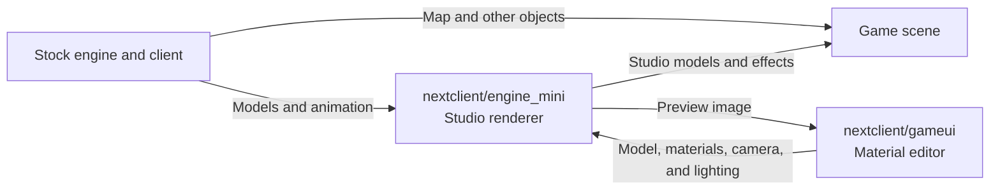
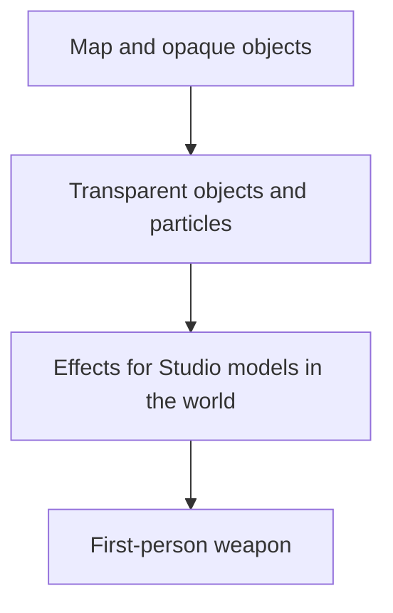

# Studio renderer

[Russian version](renderer-architecture.ru.md) | [Project architecture](architecture.md) | [Renderer diagnostics](renderer-diagnostics.md)

NextClient adds materials and effects for Studio models: players, weapons, and other objects in this format. The renderer in `engine_mini` draws them. The stock engine continues to draw the map and other scene objects.

How the renderer connects to the engine and material editor:

## Engine integration

The engine and stock client determine model positions and animation. NextClient uses this data to draw the models with the selected materials and effects. Transparency, object occlusion, and lighting must remain consistent with the rest of the scene.

NextClient model rendering requires OpenGL 3.3 compatibility support. When this feature is disabled or the new renderer cannot draw a model, the stock engine draws it. Models drawn by NextClient do not have the stock planar shadow; account for this difference when comparing images.

Drawing several models together can reduce CPU load. Evaluate the result using frame time and images from the same scene. The [diagnostics guide](renderer-diagnostics.md) describes the comparison procedure.

## Scene rendering order

The diagram shows the main stages of rendering a game scene. Effects for Studio models in the world are applied after objects and particles have been drawn. The first-person weapon is drawn afterward.

## Materials, effects, and preview

`engine_mini` selects model materials. A server can assign a material to an individual object. Without a server assignment, the model's material file is used, or the default material if no file is available.

`gameui` contains the editor: model selection, parameter controls, and file saving. `engine_mini` draws the model in the preview window. The game and editor use the same materials and effects, so the editor can show the result before saving.

Changes in the open editor temporarily replace the selected model's material. Closing the editor or connecting to a server ends this temporary replacement. The preview has its own camera and lighting and does not change the game view.

The [material guide](weapon-materials-authoring.md) describes editor operation. Available parameters are listed in the [material format](weapon-materials.md) and [effects reference](material-effects.md).

Expected images are described in the [Studio checks](testing/studio-rendering.md), [repeated-model rendering comparison](testing/studio-rigid-instancing.md), and [editor checks](testing/material-editor-scene.md).
