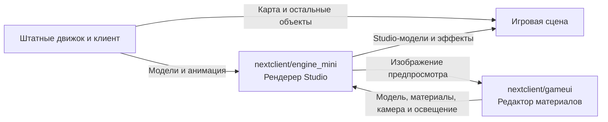
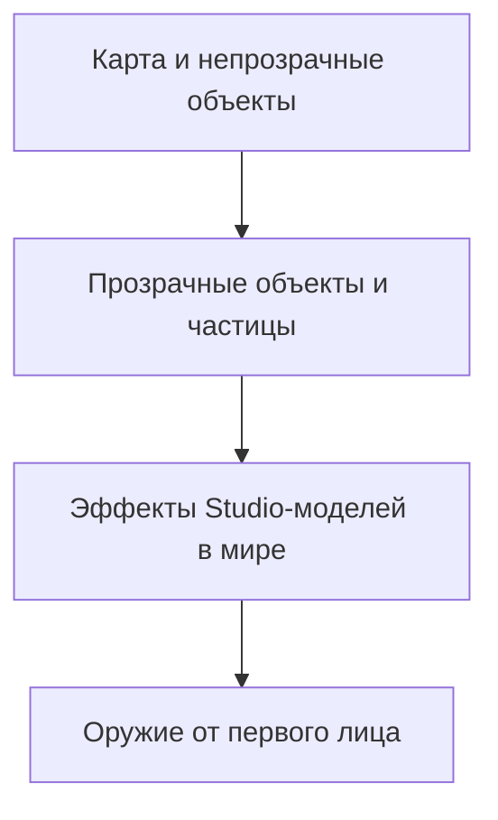

# Рендерер Studio

[Английская версия](renderer-architecture.md) | [Архитектура проекта](architecture.ru.md) | [Диагностика рендерера](renderer-diagnostics.ru.md)

NextClient добавляет материалы и эффекты для Studio-моделей: игроков, оружия и других объектов этого формата. Их рисует рендерер в `engine_mini`. Штатный движок продолжает рисовать карту и остальные объекты сцены.

Связи рендерера с движком и редактором материалов:

## Связь с движком

Движок и штатный клиент определяют положение моделей и их анимацию. NextClient использует эти данные, чтобы нарисовать модели с выбранными материалами и эффектами. Прозрачность, перекрытие объектов и освещение должны оставаться согласованными с остальной сценой.

Для рендеринга моделей в NextClient требуется OpenGL 3.3 compatibility. Если эта возможность отключена или модель нельзя нарисовать новым рендерером, ее рисует штатный движок. У моделей, которые рисует NextClient, нет штатной плоской тени; это различие учитывается при сравнении изображений.

Объединение отрисовки нескольких моделей может снизить нагрузку на CPU. Результат оценивается по времени кадра и изображению в одной и той же сцене. Порядок сравнения описан в [руководстве по диагностике](renderer-diagnostics.ru.md).

## Порядок отрисовки сцены

Схема показывает основные этапы отрисовки игровой сцены. Эффекты Studio-моделей в мире накладываются после отрисовки объектов и частиц. Оружие от первого лица рисуется после них.

## Материалы, эффекты и предпросмотр

`engine_mini` выбирает материалы моделей. Сервер может назначить материал отдельному объекту. Если такого назначения нет, используется файл материала модели, а при его отсутствии стандартный материал.

`gameui` содержит редактор: выбор модели, настройку параметров и сохранение файла. `engine_mini` рисует модель в окне предпросмотра. Игра и редактор используют одни и те же материалы и эффекты, поэтому в редакторе можно оценить результат до сохранения.

Изменения открытого редактора временно заменяют материал выбранной модели. При закрытии редактора или подключении к серверу эта временная замена прекращается. Предпросмотр имеет собственные камеру и освещение и не меняет игровой вид.

Работа с редактором описана в [руководстве по материалам](weapon-materials-authoring.ru.md). Доступные параметры перечислены в [формате материалов](weapon-materials.ru.md) и [справочнике эффектов](material-effects.ru.md).

Ожидаемое изображение описано в [проверках Studio](testing/studio-rendering.ru.md), [сравнении отрисовки повторяющихся моделей](testing/studio-rigid-instancing.ru.md) и [проверках редактора](testing/material-editor-scene.ru.md).
