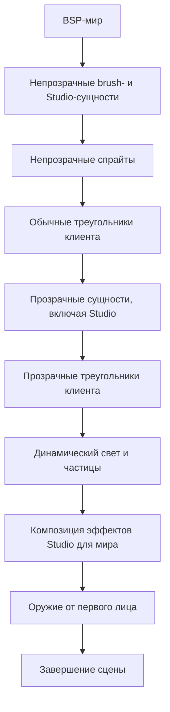
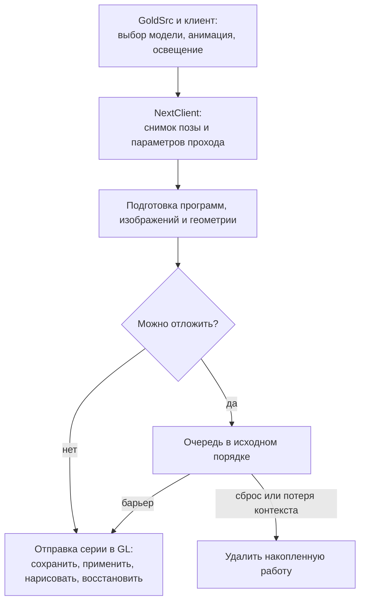
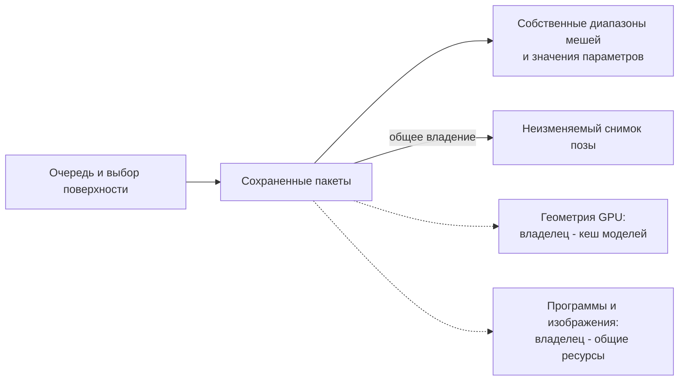
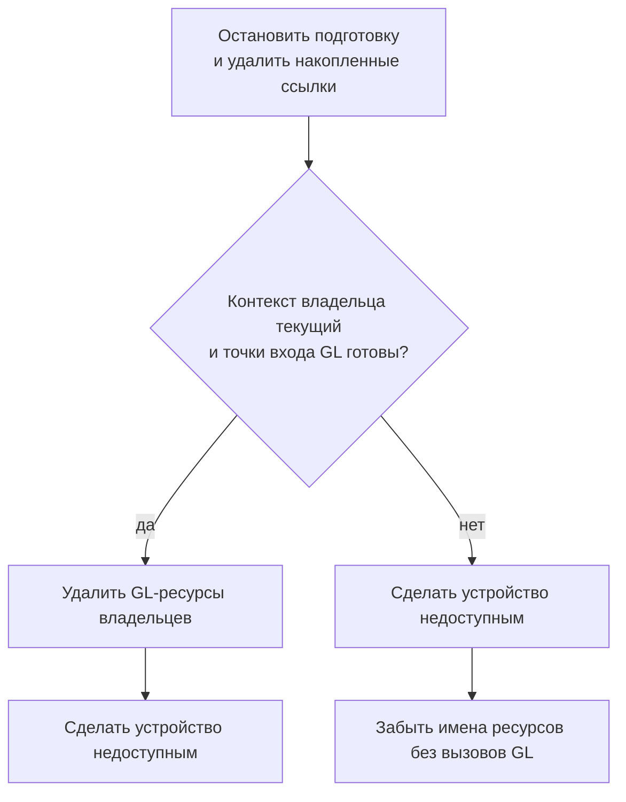

# Архитектура рендерера Studio

[Английская версия](renderer-architecture.md) | [Диагностика](renderer-diagnostics.ru.md)

## Разделение ответственности

NextClient и GoldSrc рисуют один кадр в общем контексте OpenGL. GoldSrc и клиентские колбэки выбирают Studio-модели (игроков, оружие и другие объекты `.mdl`), рассчитывают анимацию, матрицы костей и точки крепления, обрабатывают события. NextClient берет на себя отправку их геометрии: шейдеры преобразуют статические вершины по готовой позе и рассчитывают цвет поверхности. Мир BSP и brush-модели продолжает рисовать штатный движок. У радара и текста отдельные пути рендеринга.

Перехват на границе Studio API сохраняет движковые расчеты вокруг отрисовки. NextClient также задает порядок этапов сцены, поэтому отложенная работа Studio должна завершиться до этапа, который использует ее результаты или меняет общее состояние. Шейдерному пути нужен контекст OpenGL 3.3 compatibility, поскольку GoldSrc продолжает использовать фиксированный конвейер. При отключении этого пути или отказе принять вызов геометрию рисует штатный рендерер. Принятые модели не получают штатную плоскую тень, которой нужны преобразованные на CPU вершины. Это ограничение важно при сравнении изображений.

## Порядок сцены

Схема показывает основные этапы обычного представления мира при включенной отрисовке сущностей. Studio участвует в обоих обходах сущностей; оружие от первого лица рисуется отдельно. Внутри обходов действуют барьеры очереди, описанные ниже.

## От вызова движка к готовому пакету

Схема показывает путь успешно подготовленного шейдерного вызова. Отложенный и немедленный пути используют один подготовленный пакет и одинаковые правила восстановления GL-состояния.

Пока GoldSrc обрабатывает сущность, рендерер сохраняет все данные, необходимые для последующего воспроизведения прохода модели. Пакет отрисовки владеет выбранными диапазонами мешей и копиями освещения, матриц вида, тумана, параметров растеризации, выбранных базовых скинов и изменяемых значений материалов. Скин выбирается, пока текущая сущность и принудительные флаги движка относятся к этому вызову. Поэтому отправке не требуется повторно обращаться к живой сущности или читать материал, который уже мог измениться. Встроенные шейдеры воспроизводят сохраненный движковый туман (линейный, экспоненциальный или с экспонентой от квадрата расстояния), сохраняя альфу поверхности.

Полная поза костей сохраняется один раз для отрисовки модели и доступна через общий неизменяемый дескриптор. Части тела и захват предпросмотра удерживают этот снимок без копирования палитры и без риска прочитать следующую позу анимации. Эффекты используют тот же снимок при рисовании. Сброс пула поз не делает удерживаемые дескрипторы недействующими. Общая геометрия или поза не объединяет остальные параметры разных пакетов.

Подготовка разрешает программы, привязки материалов и изображения до передачи пакета в очередь, эффекты или выбор поверхности. Циклы отрисовки получают готовые числовые привязки и идентификаторы изображений, не загружая файлы и не обращаясь к каталогу. Для отсутствующего изображения материала кеш предоставляет нейтральную текстуру.

Загрузка ресурса может синхронно вызвать движок, а тот может сбросить сессию или выгрузить модель. На время таких вызовов подготовка удерживает завершенные значения в локальном владении. Перед чтением заимствованных данных модели или публикацией результата она повторно проверяет состояние операции и ресурсов. Недействующая операция прекращается, а отмененная загрузка изображения не попадает в кеш. Это позволяет отличать обычное отсутствие ресурса от отрисовки, чей контекст или сессия уже завершены.

## Общая геометрия и владение ресурсами

Сплошные стрелки показывают владение данными, пунктирные показывают заимствование ресурсов. Копии пакетов имеют собственные значения параметров и совместно удерживают неизменяемую позу. Заимствованные GPU-ресурсы требуют отдельной границы освобождения. Эффекты синхронно используют подготовленный пакет и сохраняют собственные маски.

Кешированная модель хранит геометрию всех вариантов частей тела в одной статической паре буферов вершин и индексов. Границы мешей сохраняются, а движок выбирает диапазоны для текущей сущности. Сущности с одной моделью могут использовать общие буферы, передавая разные позы, скины, материалы и параметры вида. После загрузки в GPU временные массивы преобразования на CPU освобождаются. Метаданные подготавливаются независимо, без GL, и остаются доступны для поиска материалов и редактора, даже если подготовка GPU завершилась ошибкой. Предпросмотр создает GPU-геометрию при первом рисовании и затем использует ее повторно.

`RendererResources` владеет устройством, шейдерными программами, каталогом материалов и изображениями. `RendererState` объединяет вокруг этих ресурсов владельцев моделей, материалов, отрисовки Studio, предпросмотра и жизненного цикла. Компонент отправки и пакеты заимствуют готовые программы и геометрию; удаление остается обязанностью владельцев ресурсов. Владельцы должны существовать дольше этих ссылок. Перед изменением ресурса использующая его работа должна завершиться либо быть удалена из очереди и захваченных пакетов.

Ключ кеша учитывает модельную сессию вместе со скопированным именем и идентичностью заголовка. Повторное использование адреса движком не делает геометрию другой сессии действующей. Отдельная модель текстур учитывается как зависимость: ее выгрузка сбрасывает готовность зависимых текстур и материалов, сохраняя независимые метаданные и геометрию основной модели. Поколения шейдеров и ревизии текстур также защищают пакеты и кешированные привязки от использования замененных GPU-ресурсов.

## Почему очередь и группировка имеют границы

Очередь сохраняет исходный порядок непрозрачных и прозрачных сущностей. Основной проход каждой модели предшествует ее оболочке. Последовательные подходящие пакеты образуют одну серию отправки с общим сохранением и восстановлением GL-состояния вызывающего кода. Это не разрешает сортировать их по программе или текстуре. Изменение порядка влияет на аддитивное смешивание и даже на непрозрачные поверхности с одинаковой глубиной.

Внутри обычного пакета один вызов `glMultiDrawElements` объединяет только соседние меши с одинаковыми используемыми параметрами. Вызов перечисляет диапазоны существующих буферов и сокращает обращения CPU к API при том же наборе выбранных треугольников. Каждый обычный пакет по-прежнему привязывает первую программу и передает собственные uniforms, матрицы и кости, даже если предыдущий пакет использовал ту же программу. Rigid instancing объединяет соседние подходящие пакеты и диапазоны частей тела при доказанном использовании одной кости на диапазон и точном совпадении общего сохраненного состояния. Пакеты с авторскими материалами и другие неподходящие пакеты используют обычную отправку. Условия допуска и измерения описаны в [процедуре rigid-отправки](testing/studio-rigid-instancing.ru.md).

Барьер отправляет накопленную работу перед сторонней отрисовкой, колбэком Studio-события, заменой ресурса или завершением обхода сущностей. Благодаря этому спрайты, brush-модели, штатная отрисовка и клиентские примитивы сохраняют свое место в кадре. Оружие первого лица и обычный предпросмотр отправляются сразу. То же правило действует для моделей со скинами, которые перекрашивает движок: другая сущность может изменить содержимое общей текстуры, а сохранение ее GL-имени не сохраняет пиксели.

Сторонние Studio-колбэки с прямыми вызовами GL должны задавать собственную границу отправки и приостановки очереди либо использовать `r_studio_queue 0`. При отказе уже принятая работа завершается перед штатной отправкой, отклоненные меши удаляются, а следующие части этой отрисовки остаются на штатном пути. Эти границы сохраняют порядок и предотвращают повторное рисование геометрии.

## Работа в общем контексте OpenGL

`StudioGlSubmission` управляет GL-состоянием только во время отправки серии. Он сохраняет затрагиваемое состояние вызывающего кода, применяет данные каждого пакета и восстанавливает состояние до возврата в подготовку движка или клиента. Его кеш учитывает только изменения внутри этой серии. Совпадение значений, оставленных другим рендерером, не позволяет пропускать настройку. Сэмплеры материалов занимают отдельный диапазон текстурных слотов, не затрагивая базовый скин и зарезервированные движком слоты. Применение и восстановление базовой текстуры также согласует ее учет в движке. После отправки активным остается текстурный слот 0, как требует граница с движком.

Восстанавливать состояние допустимо, только пока нативный контекст владельца остается текущим. Сброс сессии при живом контексте позволяет вернуть привязки вызывающего кода и отменить дальнейшее рисование. При потере или замене контекста сохраненное GL-состояние отбрасывается: старые имена объектов в новом контексте могут обозначать посторонние ресурсы. Полный снимок GL и проверки нативного контекста окружают фактическую загрузку отсутствующего в кеше изображения. Прогретая подготовка читает ревизии владельцев, не создавая такие снимки для каждого вызова.

## Материалы, эффекты и предпросмотр

При выборе материала учитываются серверные привязки сущности, документ модели и встроенные значения. Активная сессия редактора может переопределить материал своей цели. Пакет копирует выбранные значения, поэтому изменения редактора или сервера независимо влияют на последующую подготовку. Проверенный манифест задает общий контракт покрытия поверхности для цветового прохода, эффектов и выбора мышью. Эти проходы используют одну позу, изображения и правила видимости. Растворенные фрагменты и отверстия маски остаются согласованными. Разрешение серверных эффектов остается отдельным решением владельца материалов.

Сцены предпросмотра используют подготовку и отправку Studio со своими параметрами камеры и взаимодействия. Каждое представление эффектов владеет собственными масками. Отмена останавливает это представление без композиции его результата и без отмены внешнего представления. Ссылки предпросмотра должны быть удалены до освобождения общих ресурсов Studio, которые он заимствует. Подробности находятся в [формате материалов](weapon-materials.ru.md), [описании эффектов](material-effects.ru.md), [руководстве редактора](weapon-materials-authoring.ru.md) и [серверном API](weapon-materials-server-api.ru.md).

## Сброс, потеря контекста и завершение работы

При освобождении или потере контекста порядок зависит от возможности безопасно вызвать GL. Схема показывает эту границу; смена карты при сохранении контекста обрабатывается отдельно.

`RendererLifecycle` координирует владельцев ресурсов при смене карты, отключении, смене контекста и завершении работы. Основное правило: удалить заимствованную работу до инвалидизации данных, на которые она ссылается. При замене живой модели сначала отправляются действующие пакеты. Завершение сессии отбрасывает пакеты, которые уже нельзя безопасно отправить. Сброс карты очищает геометрию моделей и изображения материалов, сохраняя шейдерные программы. Потеря контекста сохраняет собственные метаданные CPU текущей модельной сессии. GPU-ресурсы восстанавливаются при последующем использовании.

Освобождение живого контекста явно удаляет GL-ресурсы до отключения устройства. Для этого нативный контекст владельца должен быть текущим, а точки входа GL должны быть инициализированы. При потере контекста устройство становится недоступным, затем владельцы забывают имена без вызовов удаления GL. Деструкторы также забывают имена и снимают регистрацию, не рассчитывая на наличие контекста. Изменение размера того же подготовленного контекста сохраняет ресурсы. Новому контексту соответствует новое поколение ресурсов.

Окончательное завершение работы останавливает скопированные колбэки Studio и предпросмотра до вложенного освобождения данных движка. Ресурсы освобождаются до завершения работы движковых служб, от которых они зависят. Копии исходных колбэков сохраняются для передачи вызова. Отдельное завершение рендеринга допускает последующее создание контекста.

## Шейдеры и настройки

Исходники шейдеров и манифесты программ встроены в модуль движка. Программы компилируются для текущего GL-контекста. Изменение встроенного шейдера требует пересборки и установки модуля с последующим перезапуском клиента. Параметры запуска и предварительной компиляции описаны в [подготовке встроенных шейдеров](renderer-diagnostics.ru.md#подготовка-встроенных-шейдеров).

| Настройка | По умолчанию | Назначение |
|---|---|---|
| `r_studio_shader` | `1` | Включает шейдерный путь Studio. |
| `r_studio_queue` | `1` | Разрешает упорядоченную отложенную отправку в непрозрачном и прозрачном обходах. |
| `r_studio_materials` | `1` | Включает авторские материалы. |

Очередь сохраняет порядок и совместимость пакетов при объединении экземпляров и обычной отправке. Проверка условий допуска, изображения и счетчиков отправки описана в [процедуре проверки rigid-отправки](testing/studio-rigid-instancing.ru.md).

## Исходники и проверка

| Вопрос | Откуда начать |
|---|---|
| Где сохраняются данные движка? | [StudioIntercept.cpp](../nextclient/engine_mini/src/graphics/render/StudioIntercept.cpp), [StudioRenderer.cpp](../nextclient/engine_mini/src/graphics/render/StudioRenderer.cpp) |
| Где обеспечиваются порядок и отправка? | [StudioQueue.cpp](../nextclient/engine_mini/src/graphics/render/StudioQueue.cpp), [StudioSubmit.cpp](../nextclient/engine_mini/src/graphics/render/StudioSubmit.cpp) |
| Кто владеет кешированными данными моделей? | [StudioModelCache.cpp](../nextclient/engine_mini/src/graphics/render/model/StudioModelCache.cpp) |
| Кто координирует время жизни ресурсов? | [RendererLifecycle.cpp](../nextclient/engine_mini/src/graphics/render/RendererLifecycle.cpp), [RenderDevice.cpp](../nextclient/engine_mini/src/graphics/render/RenderDevice.cpp) |

[Правила владельцев рендерера](../nextclient/engine_mini/src/graphics/render/AGENTS.md) задают требования к реализации. [Диагностика](renderer-diagnostics.ru.md) описывает команды, снимки и счетчики; одно лишь сокращение числа вызовов API не доказывает ускорение. [Проверка Studio](testing/studio-rendering.ru.md) и [проверка сцены материалов](testing/material-editor-scene.ru.md) разделяют автоматизированное покрытие и наблюдения разработчика в установленном движке.
