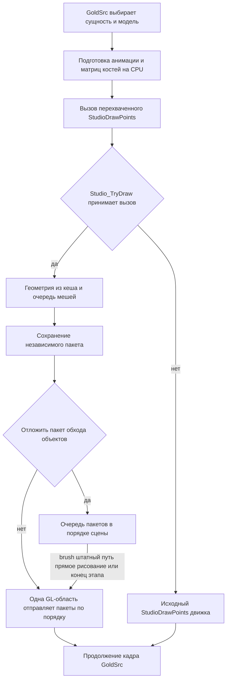
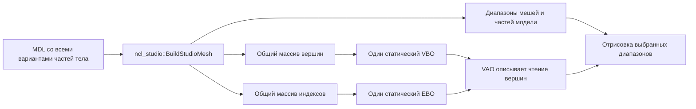
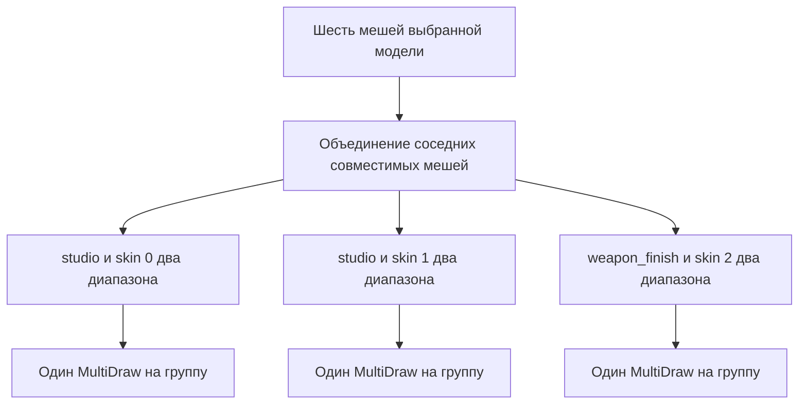

# Шейдерный рендеринг NextClient

[Английская версия](renderer-architecture.md) · [Общая схема](shader-rendering.ru.md) · [Диагностика](renderer-diagnostics.ru.md) | [Формат материалов](weapon-materials.ru.md) | [Сценарии проверки](testing/studio-rendering.ru.md)

NextClient рисует Studio-модели через статические GPU-буферы и шейдеры. GoldSrc выбирает модели, рассчитывает анимацию и подготавливает отрисовку. К Studio-моделям относятся игроки, оружие и другие объекты в формате `.mdl`. Мир BSP продолжает рисовать движок: `R_DrawWorld` и `R_DrawBrushModel` передают работу в `hw.dll` или `hw.so`.

Меш является участком модели с собственным диапазоном треугольников и ссылкой на скин. Часть тела может содержать несколько мешей; у оружия это также части конструкции.

Основные свойства реализации:

| Свойство | Текущее устройство |
|---|---|
| Хранение геометрии | Все части одного файла модели размещаются в одной паре буферов вершин и индексов. Границы мешей сохраняются. |
| Группировка мешей | Меши выбранных частей тела одной модели группируются и отправляются через `glMultiDrawElements`. |
| Повторяющиеся модели | По возможности используется общая геометрия; последовательные подходящие пакеты одного обхода объектов используют один цикл сохранения и восстановления GL-состояния. Каждый пакет загружает собственную позу и выполняет отдельные вызовы рисования. |
| Ключ группы | Программа, скин, сохраненная текстура и все используемые параметры меша и материала внутри пакета. |
| Выбор программы | Программа меняется при переходе к группе, которой нужна другая программа. Многие режимы одной программы задаются uniform-переменными. |
| Требования и включение | `r_studio_shader` имеет значение по умолчанию `1`. Для пути Studio нужен OpenGL 3.3. |

При группировке мешей несколько диапазонов геометрии отправляются одним вызовом MultiDraw. Это сокращает число обращений CPU к OpenGL при том же количестве отправляемых треугольников.

## Владение ресурсами и состоянием

Пространство имен `render` объединяет типы, функции и константы подсистемы рендеринга, включая `render::GpuBuffer`, `render::IDeviceResource` и `render::StudioDrawQueue`. Интерфейсы сцены и материалов между DLL остаются публичными контрактами движка. Документы материалов и преобразование моделей используют API с квалификаторами `ncl_material` и `ncl_studio`. Вспомогательные функции разбора и записи находятся в `ncl_material::detail`. Захват кадра использует `ncl_gl::FrameImage`, `ncl_gl::CaptureFramebuffer` и `ncl_gl::WriteTga`.

### Устройство, ресурсы и модели

`RendererResources` создает `RenderDevice`, `ShaderManager`, `MaterialManifestCatalog` и `MaterialTextureCache` в порядке зависимостей. `RenderDevice` хранит реестр ресурсов, идентификатор нативного контекста, возможности GL и поколение. Владельцы программ и изображений регистрируются при создании и снимают регистрацию при уничтожении. Уничтожение владельца и потеря контекста сбрасывают имена без GL-вызовов. Явная очистка удаляет имена только при текущем контексте владельца.

Интеграционный адаптер очистки текстур сначала отправляет накопленные пакеты. `ShaderManager` получает отдельный бэкенд загрузки исходников и компиляции. Каталог получает ссылку на этого владельца программ и бэкенд локализации и диагностики. Кеш текстур получает устройство и загрузчик изображений. Бэкенды выполняют работу при промахах кеша или явных операциях жизненного цикла. Попадания в прогретый кеш не добавляют выделений памяти и виртуальных вызовов. Запросы программ и изображений сохраняют прямую проверку текущего нативного контекста. Свободные функции передают вызовы этим владельцам для интеграционных потребителей.

`RendererState` использует единственный корневой `RendererResources` и создает `MaterialCoverageRuntime`, `StudioEffects`, `MaterialDocumentStore`, `ServerMaterials`, `StudioModelCache` и `MaterialEditor` в порядке зависимостей. Основная композиция создает бэкенд `MaterialGameFiles` перед хранилищем документов. Инициализация игры задает каталог мода для записи файлов. Хранилище выполняет чтение документов моделей и редактора, запись файлов, диагностику разбора и чтение серверных пресетов с ограничением размера. Владелец серверных материалов передает лимит 1 МиБ только для пресетов.

Каждый кеш получает конкретных владельцев устройства, документов, каталога и поколений программ и серверных материалов. `StudioRenderer` один раз связывает ссылки на кеш моделей и серверные материалы, затем вызывает их методы напрямую при подготовке. Граница отрисовки передает в `BindingFor` признак активной сетевой сессии. Операция подготовки модели явно получает колбэк отправки накопленных пакетов и вызывает его только перед заменой устаревшей записи. Попадание в кеш не вызывает этот колбэк и не добавляет повторного поиска. `StudioGeometry` и `GpuBuffer` регистрируются через переданное устройство и используют его прямую проверку текущего контекста. Деструкторы забывают имена и снимают регистрацию. Живые GL-ресурсы удаляет явная операция освобождения.

`StudioRenderer` один раз получает ссылки на конкретных владельцев ресурсов и создает `StudioMaterialRuntime(ShaderManager&, MaterialManifestCatalog&, MaterialTextureCache&, performance::PerformanceMonitor&)`, затем передает этот компонент по ссылке в `StudioGlSubmission`. Владельцы должны существовать дольше этого компонента. Конструктор не ищет ресурсы и не выполняет GL-вызовы. Поколение программ всегда ненулевое. Заимствованные указатели на программы действительны до смены поколения владельца шейдеров. `StudioMaterialRuntime` хранит строки дескрипторов программ, указатели на программы с проверкой поколения, ключ последней настройки и 256 нормализованных значений световой гаммы. `StudioShaderInterface.h` задает упорядоченную таблицу uniform-переменных, значения и определения режимов затенения, размеры таблицы гаммы и встроенный дескриптор. `Studio_OnGammaChanged` копирует каждый четвертый элемент движковой таблицы гаммы и делит его на 1023. Подготовка первой отрисовки использует тот же адаптер. `StudioMaterialRuntime` не обращается к состоянию движка.

`RendererState` создает привязки предпросмотра, нативный бэкенд моделей и репозиторий перед `StudioRenderer`. Затем создаются `StudioInterceptState`, `PreviewModelRenderer`, `ScenePreview`, `TestQuad`, `RenderCaptureSession` и `RendererLifecycle`. Рендерер получает конкретных владельцев устройства, программ, манифестов, текстур, моделей, серверных материалов, сессии редактора, эффектов, привязок движка и диагностики. Он владеет компонентом исполнения материалов, отправкой GL-команд, очередью, кешем подготовки, состоянием отказа и вложенным стеком входов предпросмотра. Конструкторы не вызывают движок и GL. Предпросмотр получает рендерер напрямую; рендереру не нужны владельцы сцены или моделей предпросмотра.

### Перехват и захват кадра

`StudioInterceptState` владеет исходной и установленной таблицами ABI, заимствованными указателями текущей модели, заголовка и подмодели, номером отрисовки, копией освещения и режимом передачи штатных вызовов. Трамплины ABI действуют до завершения процесса и выбирают владельца из точки композиции. Методы перехватчика вызывают его рендерер напрямую. `StudioModelInputs` передает исходный API, снимок идентификаторов, освещения и номера отрисовки, а также синхронную ссылку на текущий номер. После загрузочных колбэков номер проверяется до чтения заимствованных указателей. Пакеты не сохраняют эту ссылку. `StudioEngineBindings` связывает разрешенные адреса нативных данных при инициализации, сохраняет значения настроек и вида на границе операции, преобразует гамму при уведомлении и согласует учет текстурного блока 0 движка при установке сохраненного скина.

`RenderCaptureSession` владеет состоянием двух кадров A/B и исходными строками cvar. `Begin` получает конкретных владельцев cvar. Нативный бэкенд редко выполняемых операций меняет cvar, захватывает буфер кадра, записывает файл и выводит результат. Отмена снимает признак ожидания до колбэков и восстанавливает сначала настройку шейдеров, затем настройку материалов, пока нативные данные доступны. `StudioDiagnostics` владеет запрошенными записями дампа и наблюдением за освещением. Он получает привязки движка, а операция завершения сцены принимает путь и время. `TestQuad` получает свои устройство и менеджер программ. При освобождении действующего контекста координатор жизненного цикла удаляет его GL-ресурсы до инвалидирования устройства. Деструкторы освобождают только данные CPU или снимают регистрацию.

### Память мешей и общие привязки

Очередь и обработчик выбора поверхности независимо владеют `StudioMeshStorage`. У каждого хранилища отдельный лимит 1 МиБ для сохраненных данных мешей. При возврате буфера обнуляются заимствованные указатели программы и подготовленных привязок материала, а также GL-имя текстуры. Полные собственные значения материалов сохраняются. Учет включает емкость массивов мешей, параметров и переопределений, а также всех строк, включая неактивные ссылки на текстуры. Емкость коротких строк учитывается с запасом. Служебные данные аллокатора, учетные записи хранилища и активные пакеты в этот лимит не входят.

Получение буфера вычитает сохраненный размер. Сброс, завершение выбора поверхности, потеря контекста и отмена освобождают сохраненные данные. Частный `mesh_count` ограничивает поиск скина и откат; перед выбором поверхности, эффектами и публикацией в очередь массив сокращается до этого размера. Совместимая структура материала позволяет повторно использовать вложенную память. Изменение структуры, отсутствие материала, превышение лимита и переписывание хвоста параметров ограниченных эффектов могут требовать выделений. Возврат буфера добавляет ограниченный проход для учета емкости. Подтверждается повторное использование выбранных буферов; ускорение и отсутствие любых выделений памяти не измерялись.

`StudioBindings.h` задает общую схему привязок для отправки геометрии, сохранения GL-состояния, эффектов и предпросмотра: привязка костей `0`, базовая текстура на слоте `0`, зарезервированные движком слоты `1` и `2`, восемь текстур материала начиная с `3`. `kStudioTouchedTextureUnits` определяет сохранение привязок сэмплеров и очистку предпросмотра. Проверки в потребителе подтверждают, что диапазон совпадает с лимитом пакета материалов, помещается в битовую маску и не превышает 16 текстурных слотов фрагментного шейдера, гарантированных GL 3.3.

`Manifest_Get` публикует только встроенные пары шейдеров с совпадающими манифестами и проверенными контрактами рендерера. `StudioContract_For` читает этот проверенный допуск. `StudioContract_EffectsV1` предоставляет неизменяемое описание привязок GLSL для сброса uniform-переменных покрытия поверхности и не дает материалу доступ к эффектам. Загрузка прозрачности, выбор мышью, допуск эффектов, проекция границ, входы маски и композиция читают роли и значения по умолчанию из общего профиля. `StudioContract_DisableRestrictedEffects` записывает явные скалярные нули для обеих ограниченных активаций, даже если значения материала пропущены. Их конечные значения по умолчанию могут различаться в пределах фиксированных диапазонов; остальные семантические значения по умолчанию должны точно совпадать. См. [контракт манифеста и добавление программ](weapon-materials.ru.md#манифест-программы).

### Редактор и серверная синхронизация

`MaterialEditor` получает конкретных владельцев моделей, серверных материалов, программ, манифестов и документов. Он владеет значением `MaterialEditSession`: выбранной моделью и сущностью, копиями материалов выбранных текстур и снимками параметров для отмены предпросмотра. Экспортируемый `render::MaterialEditInterface` возвращает тот же экземпляр редактора из `RendererState`. Редко вызываемые методы API передают проверку текущего соединения в операции чтения источников, чтобы каждая следующая текстура учитывала вложенные загрузки и сбросы. `StudioRenderer` один раз связывает прямую константную ссылку на сессию и проверяет доступность редактирования на границе отрисовки. Поиск перекрытия читает только собственные записи сессии, без виртуального вызова, выделения памяти или обращения к каталогу и файлам. Сохранение объединяет выбранные записи с документом через переданное хранилище и напрямую вызывает `StudioModelCache::ReloadDocuments`.

`ClientStringRegistry` владеет ограниченным реестром из 2048 строк. Его конструктор не регистрирует сообщения и не вызывает движок. Адаптер `cl_string_registry` разбирает сообщения, регистрирует команды и при переполнении сначала сообщает причину, затем отключает клиент. `engine.cpp` передает единственные экземпляры реестра и серверных материалов в `MaterialSyncSystem`. Обработчик копирует все строки до вызовов загрузки пресетов, различает замену материалов и полного набора параметров, публикует сетевой снимок только после принятия замены и удаляет прежнего владельца только после успешного переноса. `CL_ClearClientState` сначала завершает сессию и заимствованную работу рендерера, затем очищает синхронизированные сущности, реестр строк и серверные материалы.

`MaterialSyncSystem` владеет сетевыми ID, дельтами и преобразованием строк реестра. `ServerMaterials::ReplaceOwner` копирует упорядоченные запросы привязок и полный набор параметров владельца. `ServerMaterials::ReplaceOwnerParams` восстанавливает только его материалы из кешированных пресетов и применяет сетевую политику эффектов. `ServerMaterials::RemoveOwner` сохраняет других владельцев и консольные привязки. Политика ограниченных эффектов получает проверенный манифест из каталога этого владельца. Явные вспомогательные функции контракта используют только переданный манифест. Каждая отрисовываемая сущность индексирует своих владельцев и сохраняет материалы, исключенные лимитом допуска из 16 текстур. Сначала места занимают консольные текстуры, затем владельцы в порядке убывания ID синхронизации и привязки в порядке запросов. Общая текстура занимает одно место. Первый допустимый запрос задает ее позицию, а последнее допустимое назначение задает материал. Изменение допуска сохраняет копии материалов незатронутых владельцев. `BindingFor` и `AnyBindingMatches` исключают недопущенные текстуры; предикат продолжает учитывать скрытых владельцев допущенных текстур. Указатели запросов действуют до изменения материалов, а меши очереди владеют своими копиями материалов. Правила синхронизации и лимитов описаны в [серверном API](weapon-materials-server-api.ru.md).

### Подготовка изображений

Подготовка изображений выполняется отдельной синхронной фазой. `FlushPending` ограничивает диапазон мешей, перемещает все содержимое подготавливаемого пакета в локальный завершенный пакет и сбрасывает построитель до загрузки отсутствующих в кеше изображений. Локальный пакет сохраняет материалы и пути при повторном входе. Синхронный `TextureLoadGuard` проверяет состояния рендерера, программ, текстур и устройства сразу после нативного колбэка текстуры. Отмененная загрузка не создает GL-текстуру и не публикует результат в кеше. Для обычного отсутствующего файла сохраняются кеширование ошибки и нейтральное изображение. Каждый меш хранит фиксированные числовые привязки текстур и покрытия поверхности, а также принятый манифест. Подготовка покрытия учитывает сэмплер, который компилятор исключил из цветовой программы. Цветовой проход, эффекты и выбор поверхности не загружают изображения и не ищут пути или манифесты. Пакет хранит ревизию кеша текстур, которая проверяется перед его потреблением. Возврат буфера очищает все числовые имена изображений и заимствованные ссылки на манифесты и программы.

Полный снимок GL создается только при реальном промахе нативного кеша изображений. Прогретая подготовка читает прямые счетчики владельцев и сохраненную идентичность устройства без дополнительного запроса нативного контекста и снимка GL. Нативный загрузчик проверяет текущий контекст вокруг внешних колбэков. После отмены предпросмотр останавливает продолжение работы. Области сохранения GL отказываются от восстановления после потери или замены контекста. При сбросе сессии с живым контекстом допустимое состояние вызывающей стороны восстанавливается, но следующие модели, выбор поверхности и вывод результата не выполняются. Эти гарантии относятся к продолжениям NextClient; произвольное продолжение закрытого движка после его колбэка не проверялось.

## Как NextClient встраивается в движок

NextClient также управляет порядком этапов сцены. Перехват `R_RenderView` в [`engine.cpp`](../nextclient/engine_mini/src/engine.cpp) вызывает собственную реализацию из [`gl_rmain.cpp`](../nextclient/engine_mini/src/graphics/gl_rmain.cpp). При обычной отрисовке мира сущности проходят следующие этапы:

1. `R_DrawEntitiesOnList` обходит `cl_visedicts`. Сущности с ненулевым `rendermode` попадают в список прозрачных через `AddTEntity`. Остальные brush- и studio-сущности рисуются в исходном порядке списка.
2. Второй обход рисует оставшиеся спрайты. К этому моменту studio-модели уже вычислили точки крепления, которые могут использовать спрайты.
3. `ClientDLL_DrawNormalTriangles` вызывается перед `R_DrawTEntitiesOnList`. В списке последнего смешаны прозрачные studio-, brush-, sprite- и alias-модели. После списка вызывается клиентский колбэк прозрачных треугольников.
4. Далее рисуются эффекты динамического света и частицы. Оружие первого лица рисуется позже в `R_RenderView`, со своей настройкой проекции.

`R_DrawStudioModel` сохраняет вызовы клиентского studio-рендера, включая события. Для `MOVETYPE_FOLLOW` функция ищет родителя в полном текущем списке сущностей и подготавливает его позу перед отрисовкой дочерней модели.

`StudioInterceptState` подменяет функции таблицы `engine_studio_api_t` до того, как клиентская библиотека скопирует ее. Перехват получает выбранную модель и подмодель части тела, а также параметры освещения. В точке `StudioDrawPoints` управление получает `render::Studio_TryDraw`.



Анимация остается на CPU: оттуда приходят готовые матрицы костей. Вершинный шейдер применяет эти матрицы к вершинам и нормалям. Это GPU-скиннинг, то есть преобразование геометрии согласно позе скелета на GPU.

Стандартная программа также вычисляет освещение вершин, chrome-координаты и расширение glow shell. Фрагментный шейдер читает текстуру и формирует цвет пикселя.

## Как хранится геометрия

`StudioModelCache` владеет записями, которые различаются по скопированному имени модели, указателю на заголовок и поколению модельной сессии. В каждой записи `StudioModelMaterials` владеет метаданными CPU, текстурами, документами и разрешенными материалами, а `StudioGeometry` хранит диапазоны мешей, границы костей, буферы и VAO. `Models_PrepareMetadata` читает блок кеша с проверкой границ через `ncl_studio::ReadStudioMetadata` и `ReadStudioTextures`; чтение не требует пикселей встроенных текстур или подготовки GL. Корректные метаданные остаются доступны при ошибке преобразования или загрузки геометрии. Ошибка чтения метаданных исключает всю запись из списка редактора. Пакет `ncl_studio` сохраняет все проверенные варианты частей тела, а редактор ограничивает число сочетаний значением 64.

При первом обращении к геометрии `render::Models_PrepareGeometry` вызывает `ncl_studio::BuildStudioMesh`. Конвертер преобразует полосы и веера треугольников из MDL в индексированный список треугольников. Он обходит все варианты частей тела файла, а выбор варианта для конкретной сущности остается за движком. Подготовка предпросмотра загружает модель и при необходимости файл текстур с учетом бюджета `PreviewModelRepository` и возвращает принадлежащие кешу метаданные. Геометрия подготавливается при отрисовке, которая отдельно сообщает о доступности рендерера.



VBO хранит вершины, EBO хранит индексы треугольников, а VAO описывает привязанные буферы и формат вершины. У каждого меша остаются `first_index`, `index_count` и `skinref`. Поэтому две части модели могут лежать в разных участках буфера и попасть в один батч.

Общая пара буферов хранит геометрию всех частей одной модели. Конвертер создает вершину для каждой записи исходной полосы или веера треугольников. Разные файлы моделей также получают отдельные буферы. Если несколько сущностей используют ту же модель из кеша, буферы общие, а поза и отправка на отрисовку у каждой свои.

После загрузки в GPU CPU-массивы вершин и индексов освобождаются вместе с выделенной для них памятью. На CPU остаются диапазоны и сведения, необходимые для выбора мешей и материалов. Геометрия остается в статических буферах. Для каждой отрисовки загружаются сохраненные матрицы костей.

При замене заголовка модели с тем же именем кеш сначала отправляет накопленные пакеты с действующими ресурсами, затем освобождает геометрию. Другое имя с тем же адресом заголовка получает собственную запись. Замена только заголовка текстур обновляет принадлежащие кешу сведения о текстурах и разрешенные материалы, сохраняя геометрию. `Models_ResolveMaterialByName` проверяет поколения шейдеров и серверных материалов перед возвратом значений по умолчанию и источников материала. Перечитывание документов сохраняет скопированные метаданные.

Подготовка метаданных и материалов получает фактическую модель, которой принадлежат текстуры, от кода поиска текстур Studio или бэкенда предпросмотра. Владелец CPU-данных копирует ее ограниченное имя и проверяет его вместе с указателем на заголовок текстур. Перезагрузка, выгрузка или повторное использование слота отдельной модели текстур сбрасывает готовность зависимых текстур и материалов, даже если прежний указатель кеша уже равен null и новое выделение использует тот же адрес. Независимые метаданные основной модели и ее геометрия GPU сохраняются. Перечисление моделей редактора и все методы чтения материалов, текстур, скинов и частей тела требуют готовых метаданных и текстур. Внутренний доступ к метаданным позволяет получить сохраненные данные основной модели.

При загрузке моделей сначала отправляются накопленные пакеты с действующими ресурсами, затем выборочно сбрасываются данные перехвата. Владелец перехвата очищает только данные выбранной модели и сохраняет освещение и текущую подготовку незатронутой основной модели при вложенной загрузке отдельной модели текстур. Полный ключ кеша отрисовки публикуется после возврата из поиска текстур. Инвалидизация текущей основной модели изменяет серийный номер отрисовки, который повторно проверяется до чтения заимствованных данных. Недействующие указатели не восстанавливаются из сохраненного снимка.

`Models_ForgetSessionMetadata` вызывается после сброса очереди, увеличивает поколение модельной сессии, очищает список имен редактора и сохраненные указатели на заголовки без вызовов GL. Сохраненная геометрия остается недоступной, даже если новая сессия использует те же имя и адрес заголовка. `Models_ForgetModel` выборочно исключает модель перед ее освобождением в `Mod_UnloadFiltered` или повторным использованием существующего слота в `Mod_FindName`; метаданные остальных моделей и учет бюджета предпросмотра сохраняются. `Mod_ClearAll` и `Mod_ResetState` завершают всю сессию и сбрасывают учет предпросмотра. `Models_Clear` требует пустой очереди и освобождает действующие ресурсы GPU либо забывает имена недоступного контекста. Потеря контекста сбрасывает указатель последней найденной записи и подготовку GPU, сохраняя метаданные CPU действующей модельной сессии. Следующая отрисовка повторно создает геометрию.

## Как сохраняются данные отрисовки

`TryDrawSubmission` собирает меши частей тела в `PendingModel`. Подготовленные на CPU данные повторно используются для одной тройки: серийный номер отрисовки, заголовок модели и сущность. Для этой тройки матрицы костей копируются один раз. Захват напрямую заполняет повторно используемую память и явно задает нулевой цвет оболочки для обычного прохода. Очередь поддерживает копирование и перемещение пакетов. Для завершенного прохода создается независимый `render::StudioDrawPacket` со следующими данными:

- Поза: 128 матриц размером 3 на 4, всего 6144 байта.
- Освещение, источники света сущности, blend, гамма, chrome/glow shell и зеркальность.
- Матрицы model-view и projection, унаследованные depth/blend-параметры.
- Диапазоны мешей, флаги, выбранные базовые GL-текстуры и копии значений материалов.

`StudioSetupSkin` выполняется при сохранении данных отрисовки, пока текущая сущность, цвета remap и принудительные флаги относятся к этой отрисовке. Поздняя отправка использует сохраненную привязку текстурного слота 0. При принудительном chrome сохраняется спрайт оболочки, выбранный клиентом. Внутри пакета повторный индекс скина использует уже сохраненный результат.

Пакеты непрозрачного, а затем прозрачного обхода поступают в `render::StudioDrawQueue` в порядке соответствующего списка объектов. Основной проход предшествует оболочке, оба предшествуют следующей сущности. Полный `cl_visedicts` остается доступным для подготовки родителя FOLLOW. Очередь содержит до 128 пакетов; при заполнении предыдущая серия отправляется до добавления следующего пакета. Контейнер мешей частей тела расширяется до конца текущего вызова. При отказе удаляются только меши текущего вызова.

Ранее принятые части отправляются перед штатной отрисовкой; следующие части этой модели остаются на штатном пути. Накопленные меши можно оформить в пакет при переходе к другой модели или рендереру: все необходимые входные данные уже скопированы.

Пакет сохраняет число костей текущей модели. UBO содержит 6144 байта для 128 костей; пакеты только со встроенным путем загружают `bone_count * 48` байт. Пакет с материалом, программа которого отличается от `studio_legacy`, загружает полную позу для совместимости с пользовательскими шейдерами.

Списки мешей и полные значения материалов принадлежат пакету до завершения отправки и ее уведомления. Затем очередь принимает живые буферы в пределах своего лимита удерживаемых данных 1 МиБ; сброс освобождает эти буферы. Временные массивы количества индексов и смещений используют общий буфер временной памяти размером 32 МиБ для встроенного пути при наличии места. Для пакетов с программами материалов, отличными от `studio_legacy`, и при нехватке места используются собственные повторно используемые массивы. Подготовка изображений и отправка используют общую временную память в разных фазах.

Накопленная очередь отправляется перед отрисовкой спрайтов, brush-моделей, alias-моделей, штатной геометрии и теней, отладочной отрисовкой Studio, `TriAPI::Begin`, вызовом `HUD_StudioEvent`, заменой ресурсов и завершением каждого обхода объектов. Отложенная отправка прозрачных пакетов заканчивается до завершающего изменения состояния GL и клиентского колбэка прозрачных треугольников. Во время выполнения обработчика Studio-события пакеты отправляются сразу. Оружие первого лица и обычные модели предпросмотра отправляются сразу. Модели с текстурами `Remap*` или `DM_Base.bmp` также отправляются немедленно: движок может менять содержимое этих текстур при смене цветов. Обычные небольшие модели при этом сохраняют общую серию.

`r_studio_queue 1` включает очередь подходящих пакетов в непрозрачном и прозрачном обходах, значение по умолчанию `1`. Сторонний studio-рендер, вызывающий OpenGL напрямую внутри `StudioDrawModel`/`StudioDrawPlayer`, должен использовать `render::Studio_Flush`/`render::StudioQueuePause` перед прямым рисованием либо `r_studio_queue 0`. Перехваченные вызовы Studio API, `TriAPI::Begin` и обработчики событий обеспечивают предусмотренные границы отправки очереди.

Сброс очереди при отключении, освобождении API, аварийном завершении и потере контекста выполняется без GL-вызовов. Перед заменой геометрии отправляются пакеты с действующими ресурсами. Каждый пакет хранит собственные копии значений материалов.

## Как получаются батчи

`render::StudioGlSubmission::Draw` сохраняет исходный порядок всех мешей пакета, включая аддитивные. При совпадающей глубине `GL_LESS` сохраняет первую поверхность, а `GL_LEQUAL` оставляет последнюю. Поэтому порядок влияет на изображение даже при отключенном смешивании и включенной записи глубины. Группировка объединяет только соседние совместимые записи; GPU-буферы остаются на месте.

Признак аддитивного меша здесь имеет точное условие: `STUDIO_NF_ADDITIVE` при фактическом режиме `kRenderNormal`. Режим смешивания всей прозрачной сущности также зависит от подготовки движка. Перед каждой группой рендерер восстанавливает сохраненные параметры смешивания и записи глубины, затем применяет параметры маски или аддитивного меша.

Соседние записи образуют группу при совпадении программы, скина, сохраненной текстуры, маски, chrome, режима освещения, масштаба UV, additive и используемых значений материала. Для группы собираются количества индексов и смещения, затем выполняется:

```cpp
glMultiDrawElements(GL_TRIANGLES, counts, GL_UNSIGNED_INT, offsets, group);
```

Вызов перечисляет несколько диапазонов одного EBO. CPU обращается к API один раз, но внутри остаются отдельные составляющие отрисовки.



В этом примере меши неаддитивные, а остальные параметры группировки совпадают внутри каждой пары. Поэтому шесть диапазонов дают три вызова API. Число треугольников остается прежним.

Группа сохраняет индекс скина движка вместе с идентификатором выбранной текстуры GL. Новое используемое свойство меша должно участвовать в проверке совместимости либо быть общим для всего пакета.

## Управление GL-состоянием

`render::StudioGlSubmission` владеет GL-состоянием только во время отправки серии. Перед отправкой серии состояние сохраняется, после отправки восстанавливается. Затем управление возвращается к подготовке следующей модели в движке или клиенте.

| Граница | Что выполняется |
|---|---|
| Начало серии | Один раз сохраняются программа, VAO, привязки array/UBO, диапазон UBO, матрицы, параметры фиксированного конвейера и привязка базовой текстуры. |
| Каждый пакет | Применяются его сохраненные матрицы и параметры глубины и смешивания, задается отсечение граней, кости загружаются в общий UBO, VAO меняется при необходимости. |
| Первая группа пакета или другая программа | Выполняется `glUseProgram`; привязка повторно используется только внутри этого пакета. |
| Пара пакет/программа | При необходимости настраивается программа; освещение, blend, гамма, источники света, chrome/shell и зеркальность обновляются, даже если предыдущий пакет использовал ту же программу. |
| Первая привязка текстуры материала к слоту | Привязка слота сохраняется до первого изменения. Учитываются только фактически используемые материалами слоты. |
| Каждая группа | Задаются alpha/depth/additive, параметры материалов и сэмплеры, привязывается сохраненный скин, обновляются UV/shade/chrome. |
| Конец серии | Возвращаются программа, VAO, буферы, диапазон UBO, матрицы, параметры фиксированного конвейера и сохраненные текстурные привязки. Активным остается текстурный слот 0. |

Кеш привязанной программы действует только внутри пакета. Каждый пакет явно привязывает свою первую программу, чтобы последовательные позы оставались независимыми в контексте совместимости. Перед отправкой групп каждый пакет применяет свои кости, освещение, blend и параметры глубины. Masked-группы используют `GL_GREATER, 0.5` и включают запись глубины. Аддитивные группы используют `GL_ONE, GL_ONE` и отключают запись глубины.

Базовый скин использует текстурный слот 0. Сэмплеры материалов занимают слоты начиная с 3 в порядке манифеста; слоты 1 и 2 остаются для учета lightmap/detail в движке. Каждый активный объявленный сэмплер получает выбранную или нейтральную текстуру. Учет привязки базового скина в движке синхронизируется при отправке и восстановлении сохраненной текстуры.

`StudioMaterialRuntime::ConfigureProgram` настраивает блок Bones, базовый сэмплер и собственную таблицу световой гаммы при уже привязанной программе. Ключ учитывает номер GL-программы, поколение шейдеров и ревизию гаммы. Число групп, пакетов и привязок Studio-программы описывает разные операции. Диагностический счетчик не включает восстановление программы вызывающего кода и постороннюю работу с шейдерами.

`StudioMaterialRuntime` хранит стабильную запись привязок каждой принятой программы. Подготовка один раз за поколение шейдеров определяет расположения uniform-переменных в порядке параметров манифеста, индекс блока Bones, расположения базового сэмплера и световой гаммы, включая неактивные uniform-переменные. Каждый меш в очереди или захваченном пакете предпросмотра заимствует эту запись вместе с указателем на программу. Компонент `StudioMaterialRuntime` существует дольше всех пакетов; барьеры ресурсов отправляют или отбрасывают их до смены поколения программ. Отправка передает запись напрямую в настройку и загрузку параметров. Значения параметров материала остаются в пакетах.

`StudioMaterialRuntime::PrepareImages` определяет значения по умолчанию из манифеста и загружает выбранные и нейтральные изображения до публикации пакета. `StudioRenderer::FlushPending` выполняет эту подготовку до заимствования данных для отправки. `UploadMaterial` использует подготовленные числовые идентификаторы изображений до выбора текстурных слотов материала. Каждая группа привязывает все объявленные активные сэмплеры. Сэмплеры, исключенные компилятором шейдеров, не занимают слот. Отсутствующие изображения заменяются непрозрачной белой текстурой. Затем адаптер отправки привязывает сохраненный скин и синхронизирует учет слота 0 в движке. Области измерения рендеринга находятся в коде, который выполняет GL-вызовы.

## Ограничения движка

| Решение | Причина и результат |
|---|---|
| Подмена studio-стадии через таблицу API | Клиент копирует таблицу. Подмена до копирования позволяет заменить отправку геометрии и сохранить движковые расчеты вокруг нее. |
| OpenGL 3.3 compatibility | В одном контексте продолжают работать этапы фиксированного конвейера GoldSrc. Шейдеры используют в том числе `gl_ModelViewProjectionMatrix`. |
| Статические буферы и GPU-скиннинг | Геометрия модели постоянна, поза меняется. Отдельный UBO позволяет передавать матрицы вместо преобразованных CPU вершин. |
| Общая очередь частей тела | Одна текстура может повторяться в разных частях тела. Сбор всей модели дает возможность объединить эти диапазоны. |
| Владение изменяемыми данными отрисовки | Скин и поза копируются, пока движок обрабатывает соответствующую сущность. Поэтому в очереди могут находиться пакеты нескольких последовательных моделей в одном обходе объектов. |
| MultiDraw по существующим диапазонам | Несмежные участки одного буфера можно отправить одной командой API без сборки новой геометрии каждый кадр. |
| Исходный порядок мешей | Непрозрачные поверхности с одинаковой глубиной и аддитивные поверхности зависят от порядка отправки. В группу объединяются только соседние совместимые меши. |
| Компактная вершина и освобождение CPU-массивов | Индексы костей занимают байты, нормаль оболочки хранится в нормализованных знаковых байтах. Это уменьшает данные на вершину и расход памяти 32-битного процесса. |

## Кеш программ и время подготовки

`ShaderManager` хранит скомпонованные программы. Ключ учитывает имена исходников, определения препроцессора и таблицы имен uniform-переменных и атрибутов. `StudioMaterialRuntime` сохраняет указатели без передачи владения и повторяет поиск при изменении поколения шейдеров. `InvalidatePrograms` сбрасывает указатели и состояние настройки без удаления программ и очистки значений гаммы.

После создания GL-контекста `render::Studio_WarmPrograms` подготавливает встроенную программу и поставляемые программы материалов с манифестами. Программы компилируются только из встроенных исходников при запуске, до первого кадра с моделью. Параметр `-noshaderwarmup` переносит подготовку на первое использование. Геометрия при этом все равно преобразуется и загружается при первом использовании.

## Ограничения и другие рендереры

Для модели, принятой шейдерным путем, движковая плоская тень пропускается. Ее код ожидает CPU-массив уже преобразованных вершин, который GPU-скиннинг не заполняет. Встроенный шейдер учитывает `STUDIO_NF_FULLBRIGHT`, поэтому такое содержимое может выглядеть иначе, чем в штатном движке. Оба условия важны при сравнении изображений.

Радар использует собственные программы маски, примитивов и фона в `client_mini`. Его батчер собирает новые экранные четырехугольники в CPU-массив и сохраняет порядок рисования. Смена режима смешивания, области отсечения или атласа символов завершает совместимый батч. Переход к другому типу отрисовки и изменение прозрачности также требуют отправки накопленных примитивов. Примитивы отправляются через `glDrawArrays(GL_QUADS)`. Тип фигуры и ее цвет находятся в атрибутах вершины, поэтому круги и другие фигуры могут использовать одну программу.

Слои радара отдельно обходят задания для конусов, маркеров, полос здоровья и подписей. Это сохраняет порядок рисования и позволяет каждому проходу накопить совместимые примитивы.

Адаптер общего текстового рендера также накапливает четырехугольники атласа. Он рисует их отдельно, через фиксированный конвейер OpenGL.

## Покрытие поверхности и эффекты

`RendererState` создает `MaterialCoverageRuntime(MaterialManifestCatalog&, MaterialTextureCache&, performance::PerformanceMonitor&)` и `StudioEffects(RenderDevice&, ShaderManager&, MaterialCoverageRuntime&)` после владельцев ресурсов. Компонент покрытия выбирает проверенный манифест один раз на границе операции. Затем он загружает значения ролей из манифеста и переопределения материала через переданный кеш изображений. Загрузка изображения и создание нейтральной текстуры завершаются до привязки текстур материала. Чистые функции ролей, альфа-канала и границ явно получают выбранный манифест или вычисленный радиус. Интеграционные адаптеры `material_coverage` и `studio_effects` обращаются к этим же экземплярам владельцев.

`StudioEffects` владеет стеком представлений, масками каждого представления, статистикой и компонентами `StudioEffectTargets` и `StudioEffectPasses`. Цели используют переданное устройство и хранят не более `512 * 1024` пикселей масок, буфер костей, изображения начальных точек, глубину сцены и временную глубину захвата в оконных координатах основного прохода. Проходы получают конкретные ссылки на цели, шейдеры и покрытие. `FixedShaderProgram`, определенный рядом с владельцем шейдеров, кеширует результат каждой программы маски, начальных точек, расстояния и композиции по поколению менеджера, включая ошибки.

Повторная подготовка читает числовое поколение и сохраненный указатель без поиска в менеджере, создания дескриптора, обращения к бэкенду или динамической диспетчеризации. Смена поколения разрешает повторную подготовку нужных программ. Каждый проход хранит типизированную запись числовых привязок uniform-переменных и блоков, подготовленную при смене поколения. Загрузка покрытия получает готовые расположения скалярных ролей, преобразования, окна сцены, времени и сэмплера растворения. Отрисовка мешей и композиция используют эти значения напрямую, включая сохраненные неактивные расположения uniform-переменных.

`StudioEffects` регистрируется в переданном устройстве при создании и снимает регистрацию с того же устройства в деструкторе. Конструктор не вызывает GL. Деструктор и обработчик потери устройства забывают активные представления, маски пула и временные имена без вызовов GL. Явный `Clear` удаляет действующие ресурсы только при совпадении текущего нативного контекста с контекстом этого устройства. Каждое вложенное представление владеет своими активными масками. Пул и статистика принадлежат отдельному владельцу. Интеграция `MaterialEdit_Get` и отчета о состоянии использует узкие типизированные функции доступа к редактору и документам. Тесты материалов могут составлять реальных владельцев без проходов эффектов.

Маски эффектов за стенами захватывают текущую позу и текстуры до передачи пакета в очередь. Сравнение глубины, обводка и свечение выполняются после мировой сцены и перед оружием первого лица. Предпросмотр использует отдельный набор масок для каждой проекции. См. [эффекты материалов](material-effects.ru.md).

## Сцены и модели предпросмотра

Подсистема `render::preview` владеет сценами предпросмотра, выбором поверхности, подготовкой моделей через движок и их отрисовкой. `RendererState` создает `PreviewEngineBindings`, `PreviewAssetBackend`, `EnginePreviewModelBackend`, `PreviewModelRepository`, `PreviewModelRenderer` и `ScenePreview` после их конкретных зависимостей. Инициализация передает разрешенные указатели движка и его колбэки. Таблица studio-интерфейса привязывается отдельно, когда клиент возвращает ее. `EngineMiniUninitialize` восстанавливает измененную таблицу и очищает заимствованные указатели и файловые колбэки до освобождения их владельцев. Отдельное завершение работы контекста сохраняет эти привязки для повторного принятия контекста. Фабрика `ScenePreviewInterface` и адаптеры `Preview_*` используют один экземпляр сцены. Конструкторы не вызывают GL и движок.

`ScenePreview` получает конкретные устройство, шейдеры, кеш моделей, кеш изображений, рендерер и репозиторий моделей, привязки движка, эффекты, покрытие и бэкенд ресурсов. Он создает `PreviewInteraction` и `PreviewSceneTarget` из этих зависимостей и владеет независимыми сценами Wavefront. Каждый ресурс регистрируется на переданном устройстве и снимает регистрацию с него же. Деструктор и обработчик потери контекста забывают имена без вызовов GL. Явный `Clear` удаляет живые ресурсы только при текущем родном контексте устройства. Освобождение сцены явно очищает ее изображения.

Некопируемые сцены Wavefront хранятся в `unique_ptr` и сохраняют адрес на весь срок владения текстурами. Ключ нативной текстуры содержит этот адрес, тег сцены и локальный индекс группы треугольников; вместе с суффиксом размеров он помещается в нативный идентификатор емкостью 160 байт. Закрытие редактора сначала удаляет ссылки из очереди и выбора поверхности, затем освобождает геометрию и изображения материалов. Независимые сцены Wavefront, метаданные моделей в CPU и учет загруженных моделей сохраняются.

`PreviewInteraction` владеет полными снимками пакетов и сохраняет емкость массива идентификаторов между кадрами и очистками. Программы выбора и обводки используют `FixedShaderProgram`: результат, включая отказ, хранится до смены поколения шейдеров. Покрытие и альфа выбора используют один проверенный манифест для каждой поверхности. Изображения загружаются до привязки текстур материалов. `StudioPreviewInputs` содержит необязательный прямой указатель на обработчик выбора, поэтому захват пакета не вызывает виртуальный метод. Обработчик один раз за поколение шейдеров подготавливает расположения uniform-переменных покрытия и индекс блока Bones. Фиксированные uniform-переменные программ выбора и обводки используют расположения по индексам дескриптора.

`PreviewModelRepository` использует конкретный бэкенд движка и учитывает выделенные слоты даже при отказе подготовки метаданных. Для известной модели без новых слотов свободные слоты не обходятся. Подготовка может вернуть пару указателей на модель и заголовок для текущего синхронного вызова отрисовки. Рендерер использует эту пару один раз, а следующий вызов вновь разрешает модель. Загрузка через движок и подготовка метаданных повторно проверяют принадлежность заимствованных модели и заголовка. Указатели не кешируются между кадрами или изменениями сессии моделей. `PreviewModelRenderer` владеет сущностью предпросмотра, снимком освещения, исходными колбэками и указателем на измененную таблицу. Сохраненные ABI-колбэки напрямую обращаются к рендереру основной композиции. Завершение работы восстанавливает его слоты с учетом замен другого владельца; скопированные колбэки сохраняют возможность вызвать исходные функции.

`ScenePreview::Draw`, `CloseAuthoring`, барьер замены модели и `StudioPreviewContext` вызывают конкретный `StudioRenderer`. Контекст заимствует его стек входных данных и собственную область приостановки очереди. Studio-отрисовка получает входы текущей операции предпросмотра и необязательную прямую ссылку на обработчик выбора поверхности.

## Чтение и сохранение документов

`MaterialFileBackend::ReadFile` явно различает успешное чтение, отсутствие файла, превышение размера и ошибку чтения. Адаптер `Read` сохраняет результат типа bool для документов. `MaterialDocumentStore::ReadFile` передает редактору точный статус: новый документ создается только при `NotFound`. Превышение размера и ошибка чтения останавливают сохранение до записи и перезагрузки документов моделей.

Нативная реализация записывает уникальный временный файл в каталоге назначения, проверяет запись, сброс буфера и закрытие, затем выполняет проверяемую замену. При ошибке временный файл удаляется, а исходный документ сохраняется. При отказе открытия нативная реализация проверяет `FS_FileExists`: существующий документ получает статус `ReadFailed`, а `NotFound` возвращается только при отсутствии файла. Нативная реализация открывает и закрывает один файл. Она проверяет представимость размера для `FS_Read(int)` до изменения буфера, в том числе при отсутствии заданного лимита. Предпросмотр различает отсутствующую и невалидную модель.

## Явные фазы жизненного цикла

Владелец модуля `render::RendererLifecycle` доступен через `GetLifecycle`. Он предоставляет отдельные операции `OnMapReset`, `OnDisconnectBegin`, `OnClientStateClearing`, `BeginShutdown`, `ReleaseLiveContext`, `OnContextLost`, `OnContextCreated` и `OnFatalShutdown`. Конструктор не вызывает GL. Координатор хранит фазу, поколение и признак терминального завершения. Ресурсы удаляют и инвалидируют их конкретные владельцы. Сброс очереди предшествует отмене захвата, завершению редактора, очистке указателей и изменениям ресурсов. Отмена захвата восстанавливает исходных владельцев cvar до освобождения интерфейсов движка.

`context::Current` получает WGL-контекст в Windows. В Linux сохраняется приоритет ненулевых нативных дескрипторов Nitro SDL и GLX, затем проверяется уже загруженный EGL для контекстов без окна. Путь EGL использует RTLD_NOLOAD|RTLD_LAZY и закрывает временный дескриптор, не сохраняя указатель на функцию. `Device_IsContextCurrent` проверяет сохраненную доступность, совпадение с фактическим нативным дескриптором и инициализацию точек входа. Изменение размера того же подготовленного контекста сохраняет поколение и ресурсы. Неудачная подготовка допускает повтор. При замене устройство становится недоступным до вызовов владельцев по устойчивому снимку регистраций. Новое поколение принимается после сброса старых имен.

Освобождение действующего контекста очищает эффекты, ввод, цели и сцены предпросмотра, геометрию моделей, изображения материалов, буфер костей и шейдерные программы до инвалидизации устройства. `Studio_InvalidateContextReferences` очищает заимствованные ссылки и настройки компонента исполнения материалов до того, как `Shaders_Clear` удалит программы и увеличит поколение шейдеров. При потере контекста выполняется очистка имен без GL, включая `MaterialTextures_Forget` и очистку текстовых атласов. Метаданные моделей CPU и шрифты сохраняются. Ресурсы GPU создаются при первом обращении.

`BeginShutdown` окончательно останавливает сохраненные колбэки Studio и предпросмотра до вложенного завершения движка. Копии исходных колбэков сохраняются для безопасной передачи вызова. Условное восстановление слотов сохраняет замену, установленную другим владельцем. Обычное завершение работы выполняет условное отключение и останавливает ручной исполнитель до освобождения ресурсов. Отдельный `Draw_Shutdown` сохраняет установленные колбэки для последующего создания контекста. Аварийный путь явно выбирает освобождение или отказ от имен, очищает сессии рендерера, затем завершает CPU-часть и подписки. Сеть, исполнители, профайлер и передача штатного вызова остаются в адаптерах движка. Сброс карты сохраняет шейдерные программы. Границы освобождения моделей сохраняют выборочное исключение и правила учета предпросмотра.

Предпросмотр проверяет отмену после отправки накопленных пакетов и подготовки модели, до создания GL-области и использования заимствованных данных модели. Контекст предпросмотра сохраняет эпоху отмены до приостановки очереди. Каждый проход эффектов получает монотонный идентификатор своего владельца. Отмена освобождает только этот проход без композиции, сохраняет внешние проходы и не выбирает новый проход после `Clear`. Сброс сессии при живом контексте восстанавливает действительное GL-состояние; потеря контекста пропускает восстановление.

Загрузка отсутствующих в кеше изображений начинается до публикации привязок материалов. Подготовка геометрии и завершенная отправка заранее восстанавливают внешние привязки. `OnMapReset` может освободить геометрию моделей, изображения материалов и эффекты, пока нативная область загрузки сохраняет внешнее GL-состояние. Синхронная проверка отмены прекращает публикацию после такого сброса.

### Владение измерениями производительности

Композиция передает в `RendererState` ссылки на стабильные конкретные монитор и преобразователь измерений. Геометрия, компоненты покрытия и исполнения материалов, подготовка Studio, перехватчик и GL-отправка используют этих владельцев напрямую. Каждый `StudioRenderer` хранит собственную глубину вложенных замеров и передает ее своему перехватчику и отправке. Замеры независимых рендереров не влияют друг на друга. Бэкенд компиляции шейдеров получает тот же монитор при создании. Нативная подсистема мониторинга получает готовых владельцев устройства и жизненного цикла рендерера после композиции рендерера. Такой порядок не создает циклических зависимостей конструкторов.

## Где искать в коде

| Область | Источник |
|---|---|
| Перехват API и возврат в движок | [StudioIntercept.cpp](../nextclient/engine_mini/src/graphics/render/StudioIntercept.cpp), `render::Studio_PatchApi`, `StudioDrawPoints` |
| Сохранение входных данных и материалы | [StudioRenderer.cpp](../nextclient/engine_mini/src/graphics/render/StudioRenderer.cpp), `TryDrawSubmission`, `FlushPending` |
| Хранение пакетов и условия отправки очереди | [StudioQueue.h](../nextclient/engine_mini/src/graphics/render/StudioQueue.h), [StudioQueue.cpp](../nextclient/engine_mini/src/graphics/render/StudioQueue.cpp) |
| Общая загрузка покрытия | [MaterialCoverageRuntime.cpp](../nextclient/engine_mini/src/graphics/render/material/MaterialCoverageRuntime.cpp) |
| Эффекты материалов | [StudioEffects.cpp](../nextclient/engine_mini/src/graphics/render/effects/StudioEffects.cpp), [StudioEffectPasses.cpp](../nextclient/engine_mini/src/graphics/render/effects/StudioEffectPasses.cpp), [StudioEffectTargets.cpp](../nextclient/engine_mini/src/graphics/render/effects/StudioEffectTargets.cpp) |
| GL-выполнение материалов | [StudioMaterialRuntime.cpp](../nextclient/engine_mini/src/graphics/render/StudioMaterialRuntime.cpp), [StudioShaderInterface.h](../nextclient/engine_mini/src/graphics/render/StudioShaderInterface.h) |
| Группы и GL-состояние | [StudioSubmit.cpp](../nextclient/engine_mini/src/graphics/render/StudioSubmit.cpp), `render::StudioGlSubmission` |
| Идентичность моделей, сессия и список редактора | [StudioModelCache.cpp](../nextclient/engine_mini/src/graphics/render/model/StudioModelCache.cpp), [studio_model_cache.cpp](../nextclient/engine_mini/src/graphics/render/model/studio_model_cache.cpp), `render::Models_PrepareMetadata`, `Models_ForgetSessionMetadata` |
| Редактор, сессия и граница ABI | [MaterialEditor.cpp](../nextclient/engine_mini/src/graphics/render/material/MaterialEditor.cpp), [MaterialEditSession.h](../nextclient/engine_mini/src/graphics/render/material/MaterialEditSession.h), [material_edit.cpp](../nextclient/engine_mini/src/graphics/render/material/material_edit.cpp) |
| Владение метаданными и разрешение материалов | [StudioModelMaterials.cpp](../nextclient/engine_mini/src/graphics/render/model/StudioModelMaterials.cpp), [StudioMetadata.h](../nextclient/packages/ncl_studio/include/ncl_studio/StudioMetadata.h) |
| Подготовка геометрии и загрузка буферов | [StudioGeometry.cpp](../nextclient/engine_mini/src/graphics/render/model/StudioGeometry.cpp), `render::Models_PrepareGeometry`, `StudioGeometry::Upload` |
| Преобразование полос и вееров треугольников | [studio_mesh_builder.cpp](../nextclient/packages/ncl_studio/src/studio_mesh_builder.cpp), `ncl_studio::BuildStudioMesh`, `BuildMesh` |
| Диапазоны геометрии | [StudioMesh.h](../nextclient/packages/ncl_studio/include/ncl_studio/StudioMesh.h) |
| GPU-скиннинг и базовое затенение | [studio.vert](../nextclient/engine_mini/assets/shaders/studio.vert), [studio.frag](../nextclient/engine_mini/assets/shaders/studio.frag) |
| Программа материала | [weapon_finish.frag](../nextclient/engine_mini/assets/shaders/weapon_finish.frag), [weapon_finish.json](../nextclient/engine_mini/assets/shaders/weapon_finish.json) |
| Владельцы сцен предпросмотра, выбора поверхности и моделей движка | [ScenePreview.cpp](../nextclient/engine_mini/src/graphics/preview/ScenePreview.cpp), [PreviewInteraction.cpp](../nextclient/engine_mini/src/graphics/preview/PreviewInteraction.cpp), [EnginePreviewModelBackend.cpp](../nextclient/engine_mini/src/graphics/preview/EnginePreviewModelBackend.cpp), [PreviewModelRenderer.cpp](../nextclient/engine_mini/src/graphics/preview/PreviewModelRenderer.cpp), [WavefrontScene.cpp](../nextclient/engine_mini/src/graphics/preview/WavefrontScene.cpp) |
| Кеш программ | [ShaderManager.cpp](../nextclient/engine_mini/src/graphics/render/ShaderManager.cpp), [shader_manager.cpp](../nextclient/engine_mini/src/graphics/render/shader_manager.cpp), [FixedShaderProgram.h](../nextclient/engine_mini/src/graphics/render/FixedShaderProgram.h) |
| Контекст и время жизни | [RenderDevice.cpp](../nextclient/engine_mini/src/graphics/render/RenderDevice.cpp), [render_resources.cpp](../nextclient/engine_mini/src/graphics/render/render_resources.cpp), [render_device.cpp](../nextclient/engine_mini/src/graphics/render/render_device.cpp), [gl_vidnt.cpp](../nextclient/engine_mini/src/graphics/gl_vidnt.cpp), [gl_rmain.cpp](../nextclient/engine_mini/src/graphics/gl_rmain.cpp) |
| Разделение вызовов API и диапазонов | [performance_scopes.cpp](../nextclient/engine_mini/src/performance/performance_scopes.cpp), [RenderPerformanceTests.cpp](../nextclient/engine_mini/tests/RenderPerformanceTests.cpp) |
| Батчер радара | [RadarDraw.cpp](../nextclient/client_mini/src/hud/radar/render/RadarDraw.cpp) |
| Адаптер текстового рендера | [text_surface.cpp](../nextclient/engine_mini/src/graphics/text/text_surface.cpp) |
