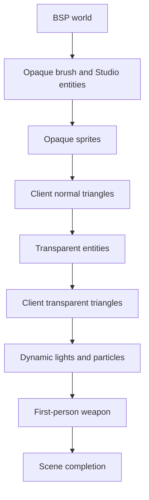
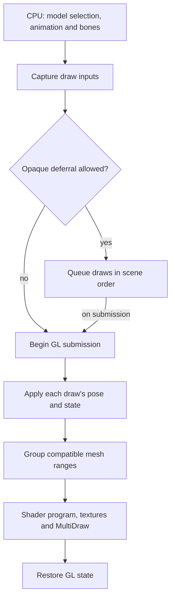

# Shader rendering

[Russian translation](shader-rendering.ru.md) | [Studio details](renderer-architecture.md) | [Diagnostics](renderer-diagnostics.md)

NextClient draws Studio models, including players and weapons, through shaders. GoldSrc and the client callbacks select models, compute animation, bone transforms, and attachments, and process events on the CPU. The GPU transforms vertices using the resulting bone matrices. BSP world and brush models use the stock engine; radar has its own shader path.

## Frame order

The diagram shows the normal world-view frame with entity drawing enabled. Studio models are drawn during the corresponding stages.

## Studio path

Each model pass produces a packet containing copies of its pose, lighting, selected skins, material values, and effective engine fog state. The built-in Studio shaders apply linear, exponential, or squared-exponential fog using eye-space depth while preserving surface alpha. Consecutive opaque packets share one GL state save/restore cycle and can reuse geometry bindings. Each packet explicitly binds its first program. Each packet uploads its own pose and issues its own geometry calls. Transparent models, the first-person weapon, and mutable remap skins submit immediately.

Compatible mesh ranges within one packet share a MultiDraw call. The queue preserves entity order; grouping operates within each packet. Unsupported submissions use the stock engine path.

## Resources and controls

`StudioModelCache` composes independent CPU metadata/material preparation and GPU geometry under copied model-name, header, and model-session identity. Bounded metadata and texture readers own the bounds, sequence count, body choices, names, and skin tables without requiring embedded pixels or GL. Material lookup and preview preparation use this CPU state before geometry is available. The preview draw converts and uploads geometry lazily, then reuses static GPU buffers. Each draw uploads its captured bone transforms. Shader programs and material textures are also cached.

The actual texture owner's copied name and header token identify companion dependencies. Companion retirement invalidates dependent authoring readiness while preserving independent main metadata and geometry, including eviction followed by same-address reuse. Loading drains valid queued packets and selectively invalidates the affected interception inputs, so a nested companion load preserves the current main capture. Draw keys are published after loading and checked against the current-main invalidation serial before borrowed data is consumed.

`StudioMaterialRuntime` owns material program descriptors, generation-checked borrowed program references, configuration state, and a normalized gamma-table copy. `StudioDraw` adapts engine gamma and captured skins; `StudioGlSubmission` calls the runtime through a typed reference. Texture loading precedes material-unit selection, and captured-skin binding follows material upload. `ShaderManager` retains program ownership.

A map change clears model geometry and material textures. Replacing live geometry submits queued packets before releasing its buffers. Model load/reload and existing-slot reuse drain valid work before engine cache allocation or release and selectively retire the affected entry. Filtered unload discards pending references and retires only selected models before freeing them; the filter is evaluated once per model. Whole-session invalidation advances a generation without GL calls, so reused name/header storage cannot restore old geometry. Sorted authoring snapshots are invalidated at retirement. Preview capacity accounting resets only at its model-owner session boundaries. Context replacement discards pending work and forgets GPU names while preserving owned metadata for the current model session; the next draw recreates geometry. Document reload preserves metadata, and by-name material queries refresh shader/server generation defaults independently of drawing.

Shader sources and program manifests are embedded in the engine module. Programs compile in memory for the current GL context. Changing built-in shader code requires rebuilding and installing the module, then restarting the client. See [embedded shader preparation](renderer-diagnostics.md#embedded-shader-preparation) for startup diagnostics and warmup controls.

Specialized coverage, picking alpha, and effects share the validated `studio_effects_v1` manifest contract. The renderer owns semantic roles; embedded manifests retain editor presentation. `ServerMaterials` owns network authorization and writes zero overrides for restricted activations, including omitted values whose embedded defaults are positive. Contract support alone does not authorize activation.

The shader path requires an OpenGL 3.3 compatibility context. `r_studio_shader 1` enables it; the default is `1`. `r_studio_queue 1` enables opaque deferral, and `r_studio_materials 1` enables authored materials. Both settings default to `1`.

## Renderer lifetime

`RendererLifecycle` composes ordered map, disconnect, client-state, context, and terminal phases. Capture cancellation restores cvars before engine services expire. Map reset discards queued work and ends metadata sessions before clearing geometry and material textures; shader programs remain cached. Selective model retirement and preview capacity accounting remain with their model owners.

Live release requires `Device_IsContextCurrent`: an alive stored native identity matching the non-null current identity and initialized GL entry points. Owners release geometry, programs, material images, submission bones, effects, preview targets, and text atlases before device invalidation. Loss first abandons performance GPU work and makes the device unavailable, then forgets old names without GL deletion while retaining model-session CPU metadata. Same-context resize preserves prepared resources and active queries; failed entry-point preparation can be retried.

Terminal shutdown stops copied studio/preview callbacks before nested disconnect, preserves the engine's manual-executor boundary, and releases resources before hook removal. Standalone drawing shutdown permits a later context. Fatal shutdown selects live release or abandonment using actual context ownership, then performs CPU performance shutdown. Active host callbacks retain their trace/frame closure until unwind completes.