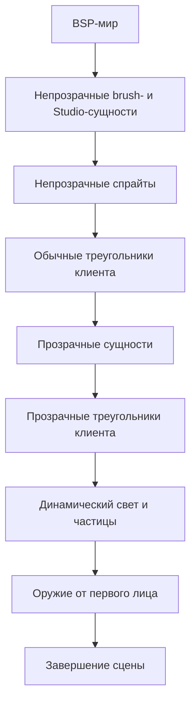
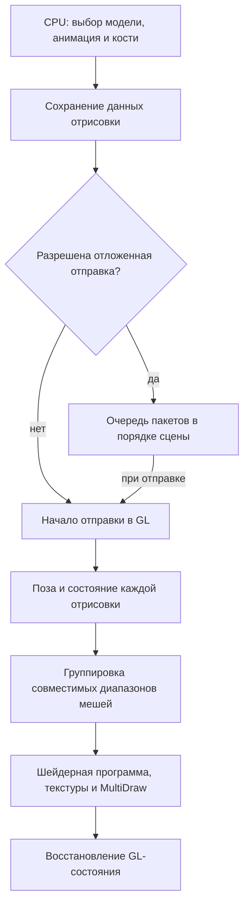

# Шейдерный рендеринг

[Английская версия](shader-rendering.md) | [Подробности Studio](renderer-architecture.ru.md) | [Диагностика](renderer-diagnostics.ru.md)

NextClient рисует Studio-модели, включая игроков и оружие, через шейдеры. GoldSrc и клиентские колбэки выбирают модели, рассчитывают анимацию, матрицы костей и точки крепления, а также обрабатывают события на CPU. GPU преобразует вершины по рассчитанным матрицам костей. BSP-мир и brush-модели рисует штатный движок; у радара отдельный шейдерный путь.

## Порядок кадра

Схема показывает порядок этапов обычного кадра при включенной отрисовке сущностей. Studio-модели рисуются на соответствующих этапах.

## Путь Studio

Для каждого прохода модели создается пакет с копиями позы, освещения, выбранных скинов, значений материалов и действующих параметров тумана движка. Встроенные шейдеры Studio применяют линейный туман, экспоненциальный туман или туман с экспонентой от квадрата расстояния. Расчет использует глубину в координатах камеры и сохраняет альфу поверхности. Последовательные подходящие пакеты одного непрозрачного или прозрачного обхода используют один цикл сохранения и восстановления GL-состояния. Между ними могут сохраняться привязки геометрии. Каждый пакет явно привязывает первую используемую программу. Каждый пакет загружает собственную позу и выполняет свои вызовы рисования. Прозрачный обход сохраняет порядок объектов и отправляет очередь перед спрайтами, brush-моделями, alias-моделями и клиентскими прозрачными треугольниками. Оружие от первого лица и изменяемые remap-скины отправляются сразу.

Совместимые диапазоны мешей одного пакета объединяются в вызов MultiDraw. Очередь сохраняет порядок сущностей; группировка выполняется внутри пакета. Неподдерживаемые вызовы передаются штатному движку.

## Ресурсы и настройки

`StudioModelCache` объединяет независимую подготовку метаданных и материалов CPU с геометрией GPU под общей идентичностью: скопированным именем модели, указателем на заголовок и поколением модельной сессии. Чтение ограниченных таблиц создает собственные копии границ, числа последовательностей, вариантов частей тела, имен и skin-таблиц без пикселей текстур и GL. Поиск материалов и подготовка предпросмотра используют эти данные до появления геометрии. Отрисовка предпросмотра преобразует и загружает геометрию при первом обращении, затем использует статические GPU-буферы. Для каждой отрисовки загружаются сохраненные матрицы костей. Шейдерные программы и текстуры материалов также кешируются.

Зависимость от companion определяется скопированным именем фактической модели текстур и указателем на ее заголовок. Освобождение companion сбрасывает готовность зависимых данных редактора и сохраняет независимые метаданные и геометрию основной модели, в том числе после вытеснения кеша и повторного использования того же адреса. Загрузка сначала отправляет накопленные пакеты с действующими ресурсами, затем выборочно очищает затронутые данные перехвата. Поэтому вложенная загрузка companion сохраняет текущую подготовку основной модели. Ключ отрисовки публикуется после загрузки, а до чтения заимствованных данных проверяется серийный номер инвалидизации текущей модели.

`StudioMaterialRuntime` владеет дескрипторами программ материалов, указателями на программы с проверкой поколения, состоянием настройки и нормализованной копией gamma-таблицы. `StudioDraw` преобразует движковую гамму и привязывает сохраненные скины. `StudioGlSubmission` вызывает runtime через типизированную ссылку. Текстуры загружаются до выбора слотов материала, а сохраненный скин привязывается после загрузки параметров материала. Программами владеет `ShaderManager`.

При смене карты очищаются геометрия моделей и текстуры материалов. Перед заменой действующей геометрии накопленные пакеты отправляются в GL, затем ее буферы освобождаются. Загрузка, перезагрузка модели и повторное использование существующего слота сначала отправляют действующую очередь, затем выборочно исключают затронутую запись до выделения или освобождения движкового кеша. Выборочная выгрузка сбрасывает накопленные ссылки и исключает только выбранные модели до их освобождения; фильтр вызывается один раз для каждой модели. Завершение всей модельной сессии увеличивает поколение без вызовов GL, поэтому совпадение имени и адреса заголовка не возвращает старую геометрию. Исключение записей сбрасывает отсортированный список имен редактора. Учет бюджета предпросмотра сбрасывается только на границах модельной сессии владельца. Смена контекста сбрасывает отложенную работу и имена ресурсов GPU, сохраняя собственные копии метаданных действующей модельной сессии; следующая отрисовка создает геометрию заново. Перечитывание документов сохраняет метаданные. Поиск материала по имени обновляет значения по умолчанию при смене поколений шейдеров или серверных материалов независимо от отрисовки.

Исходники шейдеров и манифесты программ встроены в модуль движка. Программы компилируются в памяти для текущего GL-контекста. Чтобы изменить встроенный шейдер, необходимо пересобрать и установить модуль, затем перезапустить клиент. Параметры диагностики запуска и предварительной компиляции описаны в [подготовке встроенных шейдеров](renderer-diagnostics.ru.md#подготовка-встроенных-шейдеров).

Прозрачность материала, альфа-канал при выборе мышью и эффекты используют проверенный контракт манифеста `studio_effects_v1`. Семантическими ролями владеет рендерер; оформление редактора задают встроенные манифесты. `ServerMaterials` управляет сетевой авторизацией и записывает нулевые переопределения ограниченных активаций, в том числе при пропущенных значениях с положительными значениями по умолчанию. Поддержка контракта сама по себе не разрешает активацию эффектов.

Шейдерному пути нужен OpenGL 3.3 с профилем совместимости. `r_studio_shader 1` включает его; значение по умолчанию равно `1`. `r_studio_queue 1` включает упорядоченную отложенную отправку в непрозрачном и прозрачном обходах, `r_studio_materials 1` включает авторские материалы. Обе настройки по умолчанию равны `1`.

## Жизненный цикл рендерера

`RendererLifecycle` задает порядок действий при смене карты, отключении, очистке клиентского состояния, смене контекста и завершении модуля. Отмена захвата восстанавливает cvar до освобождения движковых служб. Сброс карты удаляет накопленные пакеты и завершает сессию метаданных, затем очищает геометрию и текстуры материалов. Шейдерные программы остаются в кеше. Выборочное исключение моделей и учет бюджета предпросмотра сохраняются у владельцев моделей.

Освобождение GL-ресурсов требует успешной проверки `Device_IsContextCurrent`: сохраненный действующий native handle совпадает с ненулевым текущим handle, а точки входа GL инициализированы. Владельцы освобождают геометрию, программы, изображения материалов, буфер костей, эффекты, цели предпросмотра и текстовые атласы до сброса доступности устройства. При потере контекста сначала сбрасываются GPU-запросы монитора и доступность устройства, затем старые имена забываются без удаления через GL. Метаданные CPU действующей модельной сессии сохраняются. Изменение размера в том же подготовленном контексте сохраняет ресурсы и активные запросы. Неудачную подготовку точек входа можно повторить.

Терминальное завершение останавливает сохраненные колбэки Studio и предпросмотра до вложенного отключения, сохраняет порядок остановки ручного исполнителя и освобождает ресурсы до удаления хуков. Отдельное завершение рисования допускает последующее создание контекста. Аварийный путь выбирает освобождение или отказ от имен по фактическому владению контекстом, затем завершает CPU-часть мониторинга. Активные host-колбэки сохраняют завершение трассировки и кадра до выхода из стека вызовов.